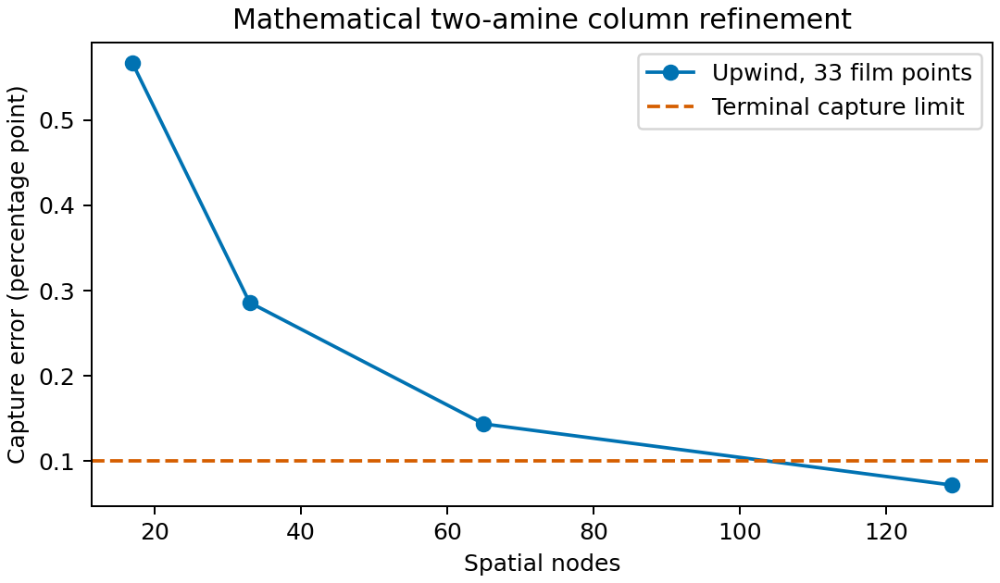

This working analysis notebook has not been independently reviewed or promoted
for manuscript use. It reads the retained result and does not run a model or
create retained values.

## Question

Does the corrected published 3C case produce a numerically and physically
accepted solution of the twelve-state conserved full-column formulation with
the trapezoidal scheme, and what evidence is still needed before comparing
solution methods?
The intended use is to establish a bounded numerical baseline for subsequent
solution-verification work.

## Conditions

The case is the corrected published 2017 3C input, represented by the retained
SI input snapshot at `input/case_3c.json`. The packed bed is 6.0 m high and
0.64 m in diameter. The resolved wet feed rates are 2.4323205276203805,
9.729282110481522, and 76.97519250729157 mol/s for the liquid entries, and
1.6540435157308098, 1.5624169375299577, 14.530683358624426, and
1.6006872732878803 mol/s for the vapor entries. Liquid inlet temperature is
318.15 K, gas inlet temperature is 316.75 K, and the gas-inlet pressure used by
the boundary is 110900 Pa. The liquid inlet temperature is an assumption; the
gas-flow moisture convention is `reported_total_wet` with `legacy_ratio`
vapor composition.

The formulation has 12 states, 7 conserved balances, 5 algebraic relations,
and 7 boundary equations. It uses the native corrected 3C full-film interface,
three film-quadrature points, two axial nodes, IPOPT, and the trapezoidal
scheme. The wall limit was 600 s. The exact retained result is
`results/conserved_public_physical_20260915T204019Z/attempt.json`; its attempt
identifier is `20260915T204030-698952033653`.

## Results

The solver returned `Solve_Succeeded` after 14 IPOPT iterations in 472.343 s.
The retained numerical acceptance flag is `accepted`, with scaled residual
infinity norm `6.371460913581593e-08` against the `1e-07` criterion and zero
scaled bound violation.

| State | At gas inlet, z = 0 | At liquid inlet, z = 6 m | Unit or basis |
|---|---:|---:|---|
| Apparent component flow 1 | 4.047470991643680 | 2.432320526769812 | mol/s |
| Apparent component flow 2 | 76.09022399713623 | 76.97519249583607 | mol/s |
| Apparent component flow 3 | 1.654043515248800 | 0.038893050827034 | mol/s |
| Apparent component flow 4 | 1.562416937357407 | 2.447386232994041 | mol/s |
| Liquid temperature | 329.3895574786238 | 318.1500000201476 | K |
| Gas temperature | 316.7500000049194 | 329.5709707501707 | K |
| Pressure | 110899.9999804368 | 110154.5012295384 | Pa |
| Holdup | 0.052016874592320 | 0.052715144240870 | retained state basis |

The two-node profile is a pair of endpoint states, not an axial profile. It
cannot resolve an interior temperature maximum, a continuous capture profile,
or the shape of any conserved quantity. A curve would overstate the evidence,
so this notebook uses tables only.

The retained physical certificate is accepted. All five scaled maxima are below
the fixed `1e-07` criterion: material `1.0353163955845279e-08`, energy
`3.5776455893663017e-10`, charge `6.530518144212249e-18`, interface
`2.3549869358501044e-08`, and boundary `3.4969443333986616e-10`. The original
bounds pass. Vapor CO2 decreases from `1.6540435152488` to
`0.03889305082703422` mol/s, corresponding to `97.6486077622%` endpoint capture.

### First axial refinement attempt

The retained public three-node attempt at
`results/conserved_public_axial_n3_20260915/attempt.json` kept the same
trapezoidal method, three film-quadrature points, `1e-07` tolerance, and
20-iteration limit. The public attempt completed in 889.577 s with IPOPT status
`Maximum_Iterations_Exceeded`. The candidate is finite and within the original bounds, and no
native callback failed, but the scaled solver residual is
`8.449045858900252e-03`. Its scaled material and interface residuals are
`4.227323014032967e-03` and `1.1893689450451015e-03`, respectively, so both
numerical and physical acceptance are rejected. This candidate is ineligible
for a refinement comparison. This iteration-limited rejection is not evidence
of formulation infeasibility.

### Matched retained-profile initialization

The bounded rerun at
`results/conserved_public_axial_n3_seeded_20260915/attempt.json` used the same
three-node grid, quadrature, tolerance, and 20-iteration limit. Its admitted
seed is the accepted two-node physical profile interpolated row by row onto
`[0, 3, 6]` m. The retained provenance verifies the source attempt, source-file
digest, model and physical inputs, expected Engine commit and verified
installed-wheel hash, all four scale vectors, and the unchanged non-node solver
settings.

This attempt completed in 910.514 s with IPOPT status
`Maximum_Iterations_Exceeded`. The scaled solver residual fell from
`1.6129296196679564e+02` at iteration zero to `1.64310785649288e+01` at
iteration 20, compared with `7.848385466224866e+01` to
`8.449045858900252e-03` for the unseeded attempt. The returned profile is
finite and within the original bounds, capture direction passes, and no native
callback failed. However, scaled energy and interface residuals remain
`9.583110269343715e-03` and `2.055855723927622`, so numerical and physical
acceptance are rejected. Linear physical-state interpolation therefore did not
improve this n3 solve under the fixed budget. This result is not a refinement
estimate, a general rejection of retained-profile initialization, or evidence
of formulation infeasibility.

## Interpretation

This attempt supports that the corrected 3C twelve-state trapezoidal assembly
can return a finite, bounded, numerically and physically accepted two-node
candidate under the declared settings. Physical acceptance is limited to the
native nodes and configured film quadrature. The result does not establish
physical validation, numerical refinement, a continuous axial maximum, or a
ranking among shooting, collocation, and difference methods.

## Limitations

Physical certification covers only native-node balances, configured
film-quadrature charge, interface and boundary residuals, original bounds, and
endpoint capture direction. It does not establish between-node accuracy.
Species mobilities use the declared case-estimated closure, and the vapor
caloric reference is provisional. The Engine identity is the installed wheel recorded
in the result: declared and expected commit
`7b1e62f0483571f8a194b32441467bdb58b45ce7`, verified installed wheel SHA-256
`91632d2812429cbd293aae70fe8d4efb00000efe2377a91546dd7374dca67ee4`; commit
evidence is unavailable from the installed distribution. The result preserves
source-tree SHA-256
`ecca148204e6ab2b3f42ebf5d898484a14afab3c000f209bc2bd26661b30b845`
and dirty-patch SHA-256
`bda7a310c9d79e10840c991dac8eeb2f4a637cdb8697e204816ef59bba9fae17`.
Those source and wheel identities must travel with any later comparison.

The earlier 900 s timeout remains a separate retained attempt with its own
identity and is not rewritten by this result. Neither attempt supplies a
matched-accuracy method comparison.

## Conclusion and next steps

The practical answer is that one coarse two-node baseline is numerically and
physically accepted, while its solution accuracy remains unresolved. Neither
the unseeded nor linearly seeded three-node attempt passed the fixed numerical
and physical criteria. A further axial retry now requires a separately designed
algebraically consistent interior initialization or continuation strategy;
changing the iteration budget would not be a matched rerun. Film-quadrature
refinement, other solution methods, and matched achieved-accuracy costs remain
later work.

## Provenance

Retained input: `input/case_3c.json` (SHA-256
`0fd3117251de9b526d72cfd83e1ffac81fe9c5ccd846677ed159cd7db1ede385`). Retained
result: `results/conserved_public_physical_20260915T204019Z/attempt.json`. The attempt was
launched through `mea_absorption_column.column.run_column`; its exact request is
retained in `resolved_config.json`. Supporting method records remain in this analysis set,
including the rejected public three-node attempt and the preceding comparison-runner
setup failure. The rejected matched retained-profile attempt is preserved in
`results/conserved_public_axial_n3_seeded_20260915/attempt.json`. The source record for the
corrected case is Morgan et al. (2020), DOI
`10.1016/j.apenergy.2020.114533`, Tables A1, A4, C2, and 6, as reconciled in
`input/case_3c_source.md`. This notebook is a working view
and its values have not been independently reviewed or promoted for manuscript
use.

## Current-pin MEA reproduction for issue 85

The two 17-node cosine-upwind repeats retain the same twelve-state MEA
calculation before changing its input declarations. Production source HEAD
was `91ced24149ce7bbed71b1cfba5c78e26bcd9c57d`; Engine 1.0.0 was
`f4566b3d0c64d05822b41fe363de47ab5cfa6a0e`, wheel SHA-256
`57bdf6c4277722fdf378107fa940fd321a4e9caeed8875165a27c318239dbd4a`.
The input is `input/case_3c.json`, with its exact phase-specific masses and
molar feeds, nine film quadrature points and nonlinear tolerance $10^{-7}$.
The runs used `nice -n 10`, a 600 s per-case wall limit and the same
single-thread BLAS conditions as the earlier profiling reference.

A fresh unclustered 17-node upwind solve supplied the accepted seed. Each
cosine repeat independently interpolated that same seed using the existing
retained-profile admission checks; no profile from the old Engine pin and no
source homotopy was used. Uniform and cosine node distributions give different
coarse-grid solutions, so the uniform capture is a seed result, not a repeat.

| Attempt | Capture (%) | Runtime (s) | IPOPT iterations | Scaled equation residual infinity norm |
|---|---:|---:|---:|---:|
| Uniform seed | 92.67000465461173 | 109.6499 | 6 | 9.74856e-8 |
| Cosine repeat 1 | 89.41488041587351 | 119.9811 | 5 | 1.78602e-12 |
| Cosine repeat 2 | 89.41488041587351 | 102.6014 | 5 | 1.78602e-12 |

Both cosine profiles are bit-identical across all twelve state rows. Their
capture difference is zero percentage points. Both existing certificates
pass: scaled material $3.69232\times10^{-16}$, energy
$4.62964\times10^{-14}$, charge $2.10450\times10^{-14}$, interface
$4.36309\times10^{-13}$ and boundary zero, each against $10^{-7}$.
A table suffices for this deterministic repeatability check; no response trend
or axial refinement is inferred from it.

The proposed declared-input and permutation acceptance is capture difference
at most $10^{-6}$ percentage point, using the greater of ten times the
observed repeat difference and this explicit floating-point allowance.
Profile comparisons use $10^{-6}$ K for temperatures, and for flows the
greater of $10^{-9}$ mol/s and $10^{-8}$ times the reference magnitude.
These allowances are proposed for unchanged-model numerical reproduction;
they do not estimate discretization error or experimental uncertainty.
The prior 89.41487679044005% result used Engine `464a989` and is not the
current-pin baseline.

Full inputs, initialization, profiles and certificates are retained under
`results/runs/issue85_current_pin_20261029/`. Its `REPRODUCE.md` records the
commands; `repeat_comparison.json` records exact attempt hashes and state
row differences, generated by `scripts/compare_issue85_repeats.py` without
rerunning the model. The companion declarations in `input/issue85/` now feed
the stage-1 calculation checked below.

This evidence is numerical reproduction, not physical validation or grid
convergence. The stationary analytical amine/water film approximation,
provisional caloric reference, imputed liquid inlet temperature and wet-gas
basis remain unchanged. Solved-state density remains the hydraulic default;
its approximately +11% loaded-density bias and approximately 12–16% lower
3C holdup limit hydraulic interpretation. No amine-blend prediction follows.
The owner reported independent readiness for the frozen first build stage.
Delivered numerical evidence still requires independent review; no manuscript
promotion is claimed.

For MA57 use: HSL, a collection of Fortran codes for large-scale scientific
computation. https://www.hsl.rl.ac.uk/ The retained attempts do not expose the
native linear-solver name.

## Declared-input MEA verification for issue 85, stage 1

The existing twelve-state equilibrium-manifold calculation now consumes the
identified thermodynamic and transport declarations in `input/issue85/`.
This check asks whether named species, analytical feeds, components, phase
supports and transport data preserve the same calculation when their input
orders change. The equations, coefficients, direct SI feeds, distinct mass
conventions and selected 3C numerical policy are unchanged.

The retained runs in `results/runs/issue85_stage1_delivery_20261029/` use the
same Engine identity and corrected 6 m 3C bed as the current-pin reference
above. Each input pair starts with its own uniform 17-node seed and then a
17-node cosine-upwind solve, with nine film quadrature points and a 600 s
wall limit per solve. The permuted input documents consistently reorder
species, feeds, reactions, calorics, component rows, charges, diffusivities
and phase supports. The physical state rows retain their quantity-based order.

| Input path | Capture (%) | Difference from reference (percentage point) | Scaled equation residual infinity norm |
|---|---:|---:|---:|
| Declared MEA | 89.41488041587351 | 0 | 1.7860244e-12 |
| Permuted declarations | 89.41488041586858 | -4.93e-12 | 2.1447162e-12 |

Both captures meet the $10^{-6}$ percentage-point allowance. Both original
equation certificates pass all $10^{-7}$ criteria. The largest certificate
residual is the interface residual: $4.36309\times10^{-13}$ for the declared
case and $5.38731\times10^{-13}$ for the permuted case. Boundary residuals
are zero. Flow, temperature, pressure, holdup, transfer-flux and loading
profiles meet the stated quantity-specific tolerances; maximum absolute
temperature and pressure differences between the two runs are
$5.51382\times10^{-12}$ K and $4.36558\times10^{-11}$ Pa.

At the reference profile, 306 phase/film-state comparisons check native
values and first and second input-direction actions of log activities and
molar enthalpy after mapping species and feed directions back by identity.
This earlier record did not compare amount or density derivatives; the
corrected verification below supersedes its action-coverage claim.
The greatest difference scaled
by $\max(1, |\text{reference SI value}|)$ is $4.45672\times10^{-12}$ against
$10^{-7}$. The greatest similarly scaled film-diagnostic difference is
$5.43046\times10^{-13}$; each film quantity also passes relative $10^{-7}$
and absolute SI allowance $10^{-10}$. Raw native difference vectors, their
observable/direction units and profile differences are in `comparison.json`.
These are ordering checks on a fixed model; a scalar comparison table is
sufficient and no axial convergence trend is inferred.

The unchanged seven-state `epcsaft_ionic` 3C replay gives
92.08186315973762% capture, differing from its own retained reference by
$1.42109\times10^{-14}$ percentage point. Its maximum RMS residual is
0.22481082656001908 against 0.5, and its scaled boundary residual is
$1.69407\times10^{-21}$ against 0.001. Its existing formal numerical
acceptance field remains `not_evaluated`; this persistent behavior check
does not promote it. Its feed basis differs from the twelve-state case,
so the two capture values are not a controlled physical-model comparison.

The complete test run reports **309 passed, 1 warning in 506.51 s**. The
warning comes from the existing deliberately invalid logarithm probe in
`test_transport_domain_guards.py`. Final Engine integration passes with the
immutable wheel recorded above. `REPRODUCE.md`, `pytest.log`,
`integration.log` and `seven_state_comparison.json` retain the replay and
verification records. Missing gas conductivity refuses before native mixture
construction; evaluating temperature outside the selected range gives a
separate state-domain failure. Four failure classes distinguish preflight,
state-domain, native-evaluation and outer-solve failures.

This evidence supports input-driven MEA reproduction and ordering invariance,
not variable-count blend verification or qualified second-solvent prediction.
Stationary analytical amine/water film constraints, the provisional caloric
reference, wet-gas basis, inlet-temperature imputation and solved-density
limitations stated above remain. Repeatability does not bound discretization
error or experimental uncertainty. Delivered independent review remains open.

## Corrected stage-1 admission and native-action verification

The independent check confirmed capture reproduction, the genuine native
permutation and unchanged seven-state behavior, but found incomplete input
refusals, a lost terminal callback failure class and missing amount/density
action comparisons. The corrected records under
`results/runs/issue85_stage1_corrected_20261029/` supersede those parts of the
earlier stage-1 record. They preserve the same corrected 3C physical basis,
phase-specific masses, selected numerical policy, Engine pin, fresh uniform
seed chains and 17-node cosine-upwind discretization.

| Corrected input path | Capture (%) | Scaled equation residual infinity norm |
|---|---:|---:|
| Declared MEA | 89.41488041587351 | 1.7860244e-12 |
| Permuted declarations | 89.41488041586858 | 2.1447162e-12 |

The declared result matches the retained baseline exactly. The permutation
difference remains $-4.93117\times10^{-12}$ percentage point, within
$10^{-6}$ percentage point. Numerical acceptance and the original-equation
physical certificate are required for both seed and cosine solves. Profiles
and all certificate criteria retain their earlier tolerances and pass.

The expanded comparison covers **species log activities, species amounts,
molar density and molar enthalpy**, in both phases, with every first and second
T/P/feed-direction action for that specified observable set. Liquid has 20
observables and 31 value/action direction combinations; vapor has 10 and 43.
Species and feed directions map back by identity. The raw column values also
compare CO2/water fugacities and total enthalpy. Units, raw differences and
direction encodings are retained in `comparison.json`; extensive native
amounts use the column's one-second basis.

Across 306 phase/film-state comparisons the maximum native difference, scaled
by $\max(1, |\text{reference SI entry}|)$, is $2.69069\times10^{-11}$ against
$10^{-7}$. The film-diagnostic maximum remains $5.43046\times10^{-13}$,
with its relative $10^{-7}$ and absolute SI $10^{-10}$ checks also passing.
The larger native maximum reflects the expanded observable set, not a change
in capture or the physical model. These are numerical invariance checks, so
the scalar table does not imply a response trend or a mesh-error bound.

Eight preflight cases reject missing conductivity, a bad hash, an unsupported
execution policy, an unknown nested domain field, dependent film rows,
duplicate analytical-component IDs, quadrature disagreement and density
disagreement before assembly or native construction. Two forced terminal
interface cases retain state-domain and native-evaluation failure classes
through CasADi wrapping; their worker inputs and outputs are retained in the
respective named failure directories. Those deliberately forced checks are
not evidence of physical nonconvergence. Undeclared calculations now retain
their built-in MEA basis without reading the analysis examples implicitly.

The corrected complete suite reports **322 passed, 1 warning in 601.86 s**.
The warning is the existing deliberately invalid logarithm timing probe.
Final Engine integration passes on the immutable wheel recorded above.
`pytest.log`, `integration.log`, the full attempt records and `comparison.json`
retain these checks. The retained comparison source-tree hash matches the
tested package bytes.

The calculation enabled remains input-driven MEA reproduction and ordering
invariance. Variable-count blend verification and qualified second-solvent
prediction remain unavailable. The stationary analytical amine/water film,
thermal-reference, wet-gas, imputed inlet-temperature and solved-density limits
stated above remain. Independent review of the corrected delivery is pending.

## Variable-count two-amine film: numerical verification {#variable-count-two-amine-film}

The shared film calculation reproduces an exact nonzero exchange solution with
**six true species, four analytical components and two distinct amine totals**.
This is numerical verification of the film calculation, not a physical solvent
prediction or admission of blends to the full column. The design and independent
Ready decision precede this calculation; the equations and numerical limits are
specified in [the stage-2 design](https://github.com/tannerpolley/MEA-Absorption-Column/issues/85#issuecomment-6509541282).

The mathematical species are CO2 C, amines A and B, water W, and neutral
complexes CA and CB. The ideal concentration manifold satisfies C+A ⇌ CA and
C+B ⇌ CB exactly. Analytical A, B and water amounts are fixed at 0.2, 0.3 and
1 mol, respectively, in a fixed volume of $10^{-3}$ m³. Temperature is 320 K,
pressure 100000 Pa, both association coefficients are 10 mol⁻¹, and every
species diffusivity is $10^{-9}$ m²/s. These are mathematical coefficients,
with no Engine mixture or physical parameter adoption. All charges are zero;
only the three stationary component rows are projected. The existing MEA
ionic checks remain necessary for the charged calculation.

At free CO2 amount $s$, the total analytical CO2 is
$F(s)=s+0.5(10s)/(1+10s)$ mol. The loading coordinate is
$\lambda=\ln(F/F_{bulk})$, holding the two individual amine amounts and water
fixed. The exact bulk and interface have $s=0.05$ and $0.1$ mol,
$F_{bulk}=13/60$ mol, $F_i=7/20$ mol, and
$\lambda_i=\ln(21/13)$. With film thickness $10^{-4}$ m, Henry coefficient
100 Pa·m³/mol and gas coefficient $10^{-7}$ mol/(m²·s·Pa), gas bulk fugacity
$55000/3$ Pa gives the exact interface fugacity 10000 Pa. Eliminating stationary
A, B and water reduces the full mobility to independent A/CA and B/CB exchange
blocks. Their closed integral is $I=1/12000000$ mol/(m·s), giving
$j_{CO2}=1/1200$ mol/(m²·s). Free CO2 and water have zero species flux;
complexes CA and CB carry the analytical CO2 while the free amines counterdiffuse.

The numerical phase supplies values and exact first/second actions through the
existing callbacks. Both this case and MEA call the same extracted conductance,
projection and trapezoidal integral. The numerical scalar gas/liquid equality
uses Brent root finding on $[0,\ln 2]$, with absolute coordinate tolerance
$10^{-12}$. Independent block matrices, polynomial roots and closed loading
derivatives provide references; the reference does not call the projection or
numerical quadrature. The retained records are in
`results/runs/issue85_stage2_20261029/`, including complete declarations,
17 state vectors per ordering, mobility matrices, first/second loading actions,
quadrature vectors, refusals, source hashes and Engine identity.

| Quadrature points | CO2 flux (mol/(m²·s)) | Relative flux error | Interface fugacity (Pa) |
|---:|---:|---:|---:|
| 9 | 0.0008332696780341422 | 7.63864e-5 | 10000.6365530 |
| 17 | 0.0008333174172733932 | 1.90993e-5 | 10000.1591606 |
| 33 | 0.0008333293541797543 | 4.77498e-6 | 10000.0397915 |
| 65 | 0.0008333323385362933 | 1.19376e-6 | 10000.0099480 |
| 129 | 0.0008333330846335338 | 2.98440e-7 | 10000.0024870 |

At 129 points, the integral is $8.33333084633534\times10^{-8}$ mol/(m·s),
the interface fugacity error is 0.002487 Pa, and gas/liquid closure is
$5.42\times10^{-19}$ mol/(m²·s). All meet the frozen limits: relative integral
and flux error $10^{-5}$, interface error 0.1 Pa, and closure
$10^{-12}$ mol/(m²·s). Successive refinements reduce flux error by about four,
consistent with the trapezoidal method on this smooth manufactured manifold.
This observed refinement applies to this film case alone.

Across both declaration orders, the largest full-matrix difference from the
independent mobility is $2.32\times10^{-22}$ mol/(m·s). The largest conductance
and its loading-derivative errors are $3.45\times10^{-22}$ and
$1.59\times10^{-22}$ mol/(m·s), respectively. Dimensionless loading tangents
and their derivatives agree to $5.56\times10^{-16}$ and $1.23\times10^{-15}$.
Analytical component reconstruction differs by at most
$1.12\times10^{-16}$ mol, reaction affinities by $1.78\times10^{-15}$ in RT
units, and mass reconstruction by $1.39\times10^{-17}$ kg. Component/element
reaction invariants pass; state and reaction charge are identically zero.
All concentrations and conductances remain positive and dissipation nonnegative
within the stated rounding allowance.

The 129-point species fluxes, in C/A/B/W/CA/CB order, are approximately
$[0,-0.0003333332338534,-0.0004999998507801,0,
0.0003333332338534,0.0004999998507801]$ mol/(m²·s).
Their differences from exact $1/3000$ and $1/2000$ exchange magnitudes inherit
the scalar flux's quadrature allowance of relative $10^{-5}$. This is separate
from the invariant residuals: stationary-component flux is below
$9.76\times10^{-19}$ mol/(m²·s), and total species flux below
$1.31\times10^{-18}$ mol/(m²·s), against $10^{-12}$ mol/(m²·s) for each.
Permutation of species, feeds, component rows and stationary rows passes all
mapped comparisons. A duplicated stationary row refuses with the existing
independence-modulo-total-flux diagnostic; it is not silently discarded.

The calculation establishes variable-count numerical verification at the film
input boundary. This stage-2 evidence is confined to the shared film. The full-column
verification below uses a separate declared mathematical phase and prescribed
property closures; Engine-backed solvent prediction retains the MEA restrictions. It does not
establish ionic-blend generality, a real second-solvent prediction, finite-rate
or volatile-amine behavior, physical validation, column grid convergence or
experimental uncertainty. No fitted export or expression language is added.
The known MEA density/holdup, area and thermal-reference limitations above
remain. Delivered independent review and investigator promotion for manuscript
use remain open.

The unchanged MEA declaration/permutation checks also pass on this shared film
owner: captures are **89.41488041587351%** and **89.41488041586858%**,
respectively, with a difference of $-4.93117\times10^{-12}$ percentage point.
The declared capture equals the retained stage-1 reference, within the unchanged
$10^{-6}$ percentage-point allowance. Both fresh uniform seeds and cosine
solves pass numerical acceptance and the original-equation certificates.
The 306 native state/action comparisons retain maximum scaled difference
$2.6906855\times10^{-11}$, with film maximum $5.4304584\times10^{-13}$.
Their full profiles, actions and certificates are retained in the MEA run
subdirectories. These verify preservation of MEA's numerical calculation;
they do not qualify a second solvent or bound column discretization error.

The full suite on the final source passes **323 tests, with one warning, in
553.46 s**. The warning is the existing deliberately invalid logarithm probe.
Final immutable Engine integration passes with Engine 1.0.0, commit
`f4566b3d0c64d05822b41fe363de47ab5cfa6a0e`, wheel SHA-256
`57bdf6c4277722fdf378107fa940fd321a4e9caeed8875165a27c318239dbd4a`.
`pytest.txt`, `integration.txt`, `verification.json`, `mea_final/comparison.json`
and `REPRODUCE.md` retain final verification and replay details. The extracted
film owner uses 270 gross executable additions against the stage-2 base,
below the 350-line ceiling; tests add 10 lines separately. Delivered independent
review remains open; these findings are not promoted for manuscript use.

MA57 acknowledgement: HSL, a collection of Fortran codes for large-scale
scientific computation. https://www.hsl.rl.ac.uk/

## Two-amine twelve-state column numerical verification {#two-amine-column}

The declared and permuted 129-node, 129-film-point columns both give
**31.454926062128543% capture**. Their capture difference is **zero percentage
points**, and the corrected original-order capture also equals its retained
pre-correction value exactly. Both ordinary `run_column` executions return
accepted profiles and original-equation certificates under the unchanged
600 s worker / 660 s outer limits, tolerance 10⁻⁹ and 40-iteration cap.

The full twelve-state calculation accepts a declared mathematical liquid with
six species, four analytical components and two nonvolatile amines, together
with a three-species vapor. The species are C/A/B/W/CA/CB; the two neutral
association reactions and analytical component rows are those of the film
verification above. Both amines participate, with unequal fixed flows
0.2 and 0.3 mol/s. The question and independent equations are fixed in the
[amended stage-3 design](https://github.com/tannerpolley/MEA-Absorption-Column/issues/85#issuecomment-6510746468).
This evidence is **mathematical numerical verification only**.

The one-metre bed has cross section 1 m² and prescribed interfacial area
100 m² per metre of bed. Liquid and vapor volume flows are 0.001 and 0.01 m³/s.
Inlet temperatures are 320 K, bottom pressure is 100000 Pa, prescribed pressure
gradient is 100 Pa/m and liquid holdup is 0.05. Species diffusivities are
$10^{-9}$ m²/s; film thickness is $10^{-4}$ m. The gas coefficients are
$10^{-7}$ mol/(m² s Pa), and the heat coefficient is 10 W/(m² K).
Every phase evaluation uses an explicit one-second reference amount, mapping
mol/s inputs to mol and extensive J outputs to W. These are mathematical
phase and mixture-property declarations; they do not adopt real-solvent
correlations or a property mixing rule.

Equal inlet temperatures, equal water fugacities and zero transferred partial
enthalpies give an exact constant-temperature, zero-water/energy-transfer
solution. The independent reference uses the closed film integral, a scalar
interface root and the separable plug-flow balance, without calling the
column assembly, projection, loading callbacks or numerical film quadrature.
It gives bottom liquid CO₂ **0.2744661315335329 mol/s**, top vapor CO₂
**0.1255338684664671 mol/s** and capture **31.526980836472482%**.
Spatial refinement assesses the existing mixed upwind discretization against
this continuum reference; it does not change the equations or solve method.

The zero thermal solution alone cannot check heat and capacity wiring.
Checkpoint 1 therefore evaluates a deliberately off-solution state at
325/330 K, with trial CO₂/water/energy fluxes of
0.0006 mol/(m² s), 0.00002 mol/(m² s) and 25 W/m². The ordinary prepared
feed vectors, separate A/B reporting, total-amine inlet loading 13/30 mol/mol,
actual scales, assembled sources and interface equations pass **51 independent
comparisons in each declaration order**. Inlet extensive capacities are
**45 and 30 W/K**. At the off-solution state they are 48 and 30 W/K;
vapor molar Cp is 23.4375 J/(mol K), distinct from its extensive capacity.
Both energy source rows are −2500 W/m, both water source rows are
−0.002 mol/(s m), and the heat-interface residual is **−25 W/m²**.
These nonzero comparisons expose inactive thermal or water wiring that
capture at equal temperatures would not test. The off-solution point is an
equation check, not a column solution.

The 129-node, 129-film-point declared solve gives **31.4549260621% capture**.
Its error against the continuum reference is **0.0720548 percentage point**,
below the specified 0.1-point limit. The bottom liquid and top vapor endpoint
flow errors are bounded by **1.3210042×10⁻⁴ mol/s**, below 2×10⁻⁴ mol/s;
the maximum CO₂ profile error has the same value. Maximum interface-flux
error is **8.1516466×10⁻⁷ mol/(m² s)**, below 10⁻⁵ mol/(m² s).
The maximum scaled original-equation residual is **5.8991×10⁻¹⁴**,
against 10⁻⁹. The retained pre-correction solve took **303.31 s**. Corrected ordinary
executions on the final source take **257.98 s** in original order and **256.46 s** in permuted
order, both within the same 600 s worker / 660 s outer limits.

The following refinement cases retain their pre-correction source identities and runtimes.
The final-source finest runs above separately verify preservation.

| Spatial nodes | Film points | Capture (%) | Capture error (percentage point) | Endpoint flow error (mol/s) | Column runtime (s) |
|---:|---:|---:|---:|---:|---:|
| 17 | 33 | 30.9604491341 | 0.5665317 | 0.001038641 | 8.72 |
| 33 | 33 | 31.2408727055 | 0.2861081 | 0.0005245316 | 15.91 |
| 65 | 33 | 31.3831837328 | 0.1437971 | 0.000263628 | 35.51 |
| 129 | 33 | 31.4548740837 | 0.0721068 | 0.0001321957 | 79.72 |
| 129 | 65 | 31.4549156665 | 0.0720652 | 0.0001321195 | 130.42 |
| 129 | 129 | 31.4549260621 | 0.0720548 | 0.0001321004 | 303.31 |

At fixed 33 film points, capture and maximum CO₂ profile errors decrease
monotonically with 17/33/65/129 spatial nodes. The 65-node continuum error
exceeds the terminal limits; it remains a useful coarse-grid result rather
than a reason to relax the limits. At 129 nodes, increasing film points
from 65 to 129 changes capture by **0.0000103957 percentage point**, below
0.001. The remaining discrepancy is dominated by spatial discretization in
this tested sequence. This does not establish a grid-independent solution.

Temperature, water and energy fluxes retain their exact manufactured values
within the prescribed checks. Pressure is 100000−100z Pa and holdup is 0.05.
Analytical-component reconstruction errors in the finest declared run are
at most 1.11×10⁻¹⁶ mol/s, against 10⁻¹²; reaction affinities divided by RT are
below 4.45×10⁻¹⁶, against 10⁻¹². Minimum sampled species amount is 0.05 mol
on the one-second basis. Fixed A/B/water/inert flows and the liquid-minus-vapor
CO₂ invariant retain the 10⁻¹⁰ mol/s allowance. Native-grid and film checks
remain distinct from between-node error, which the continuum comparison
measures here.

The full suite reports **330 passed, 1 warning in 537.19 s**. The warning
is the existing deliberately invalid logarithm timing probe. Final-mode
Engine integration passes with immutable Engine 1.0.0 `f4566b3d` and the
unchanged wheel SHA-256. The stage-1 MEA reference remains
89.41488041587351% capture; its declaration permutation differs by
−4.93×10⁻¹² percentage point. The unchanged six-species film verification
retains its 129-point flux 0.0008333330846335338 mol/(m² s), relative error
2.9844×10⁻⁷ against the exact 1/1200 reference.

The first finest permutation attempt remains retained under
`results/runs/issue85_stage3_20261029/n129_q129_permuted/`. It timed out at
600 s, with accepted algebraic initialization but no completed profile.
A bounded trace localized construction of the common-subexpression-eliminating
Jacobian before nonlinear-solver construction. The independent readiness review
reported that disabling common-subexpression elimination only for a diagnostic
probe and stopping before `nlpsol` allowed construction in about 18 s (permuted)
and 21 s (original), with identical reported graph sizes of 6,657 and 11.53
million nodes. This localizes construction as the cause; the exact mechanism
making only the permuted order slow remains unestablished.

The accepted correction changes only `always_inline` from true to false at
the two existing node-call sites. Common-subexpression elimination stays enabled;
the equations, native actions, starts, scales, limits and numerical method are
unchanged. After independent Ready, the corrected ordinary cases complete with
construction times **1.4911/1.4558 s**, solve times **244.4182/243.7249 s** and
whole-column times **257.9836/256.4634 s**, in original/permuted order.
Construction means entry to conservative collocation through return of
`nlpsol` construction; solve time is CasADi's recorded `t_wall_total` for the
nonlinear solver invocation. Preparation, initialization, residual reevaluation,
certification and serialization explain the remaining whole-column time.
Temporary pass-through timing observation changes no solver arguments or
returned solver objects.

The original/permuted flow profiles agree exactly;
temperatures and pressures agree exactly. Holdup/loading differences are at
most 1.67×10⁻¹⁶, and CO₂-flux differences are 3.26×10⁻¹⁹ mol/(m² s).
All quantity-specific profile tolerances pass. Relative to the retained
original-order profile, maximum flow difference is 2.78×10⁻¹⁷ mol/s,
holdup/loading difference 5.56×10⁻¹⁷ and CO₂-flux difference
2.17×10⁻¹⁹ mol/(m² s), with zero temperature/pressure difference.
Both scaled certificates give material residual below 3.85×10⁻¹⁶,
interface residual below 5.92×10⁻¹⁶ and zero charge/energy/boundary residuals.
The largest scaled equation residual across both solves is 5.91×10⁻¹⁴.
The original 31.454926062128543% record is unchanged.

The scalar reference agrees at integration tolerances 10⁻¹⁰ and 10⁻¹² within
10⁻⁷ percentage point. The corrected study combines the accepted pre-correction
spatial/film refinement with corrected finest executions. The finest
preservation check justifies reuse of the unchanged coarse numerical evidence;
source identities and exact comparison roots remain in `study.json`.
Complete corrected attempts, timing records, comparison values and the refreshed
checks are in `results/runs/issue85_stage3_final_20261029/`;
failed attempts and bounded diagnostics remain in the preceding run directory.

The required domain-failure correction uses one shared mathematical domain
check for value and action evaluations. An actual assembled worker evaluation
with liquid CO₂ flow set to zero now retains `state_domain_failure`, the phase,
T/P/feed inputs and the cause, rather than `outer_solve_failure` with no
evaluation failure. One new previous-failure check reproduces the rejected calculation;
the retained before/after worker records are in
`results/runs/issue85_stage3_domain_fix_20261029/`. No native Engine state or
result is manufactured. The final-source runs above include this correction.
The earlier graph-only successful runs (135.92/135.98 s) remain separately
retained; those timings are not the final-source timings.

| MEA run | Stage-1 whole time (s) | Final whole time (s) | Final construction (s) | Final solve (s) |
|:--|--:|--:|--:|--:|
| Declared seed | 121.4600 | 110.4431 | 0.1925 | 106.5673 |
| Declared cosine | 111.7225 | 102.4879 | 0.2040 | 98.3890 |
| Permuted seed | 116.7868 | 119.5777 | 0.2263 | 115.3523 |
| Permuted cosine | 110.1089 | 96.5070 | 0.2066 | 92.5872 |

These are observed wall times under shared machine load, not a controlled
speed comparison. Stage-1 construction times were not separately retained.
All four unchanged MEA solves and their native/film permutation gates pass.
The finest mathematical runs used the same limits and ran alongside the
full suite; their timing is evidence for these executions only.

This establishes variable-count numerical verification for this mathematical
neutral column, including the specified full-column permutation. It supplies
no physical validation, real second-solvent prediction, ionic-blend
qualification, finite-rate film or fitted Amine-Thermodynamics export.
The mathematical phase has no native Engine solve; the unchanged immutable
Engine identity identifies the environment. Existing MEA density/holdup, area
and caloric limitations remain. Delivered independent review and any subsequent
investigator promotion remain open.

HSL acknowledgement for MA57 evidence: HSL, a collection of Fortran codes for
large-scale scientific computation. https://www.hsl.rl.ac.uk/

## MDEA thermodynamic consumption and actions: issue 85, stage 4 checkpoint 1

The existing `reactive_bundle.engine_liquid` constructor now consumes the
identified B1 MDEA input, including its mixed reaction reference pressures,
ordered components and exported calorics. Values and the required first and
second actions pass numerical checks at **two thermodynamic states on a
candidate wheel**. This is development evidence: no MDEA absorber was solved,
and no absorber prediction or physical validation follows from these checks.
Delivered independent review and investigator promotion remain separate.

The [accepted design](https://github.com/tannerpolley/MEA-Absorption-Column/issues/85#issuecomment-6531482275)
limits this checkpoint to thermodynamic construction and actions. The source
files are retained under `src/mea_absorption_column/data/epcsaft_datasets/MDEA_B1_217026ab/`;
[the run directory](results/runs/issue85_stage4_20261030/README.md) identifies
inputs, source hashes, solver identity, attempts and verification records. The
candidate is the non-editable Engine wheel at `217026ab`, SHA-256
`b4c0f6d8eb8971abd3c0bd801cb9167b8ca602cb2a63b16a22e924d5b6727496`,
in a separate environment. The repository pin, lock file and final integration
identity remain `f4566b3d` / `57bdf6c4…`.

### Basis and returned thermodynamic values

Both states are at **313.15 K and 500000 Pa**, with 1 mol analytical MDEA and
15.433850227880626 mol water. The unloaded MDEA mass fraction is 0.30. Bulk B
contains 0.128 mol analytical CO₂; loading-path point I contains 0.258 mol.
These are `comparison:229` and `comparison:233` in the retained 5-bar
Böttinger speciation input (Table 2, printed p.7922, rows 26/27, PDF child
`W3HEICT5`). Its corrected CSV digest is
`488940ecf3fc984edeee3fa145fe6f76936396fce802b5af881bcbee70f677ef`.
The amounts are absolute mol, not flow rates. Point I is selected by
$\lambda=\ln(0.258/0.128)$ on the existing loading path; it is not a solved
interphase balance.

| Returned quantity | Bulk B | Point I |
|:--|--:|--:|
| Molecular CO₂ amount (mol) | 0.0001661461940861 | 0.0005452644373862 |
| CO₂ fugacity (Pa) | 1431.873496751 | 5101.483258150 |
| Water fugacity (Pa) | 6655.102718022 | 6619.520621318 |
| Molar density (mol/m³) | 42078.70395845 | 42048.18402384 |
| Extensive H (J on the stated amount basis) | −4578264.130067 | −4636591.072022 |
| Minimum supported species amount (mol) | 1.783757749e−9 | 1.836481960e−9 |

The complete eight-species vectors, log activities, caloric observable and
scaled action arrays are retained in `values_{B,I}_{declared,permuted}.json`
and `actions_{B,I}_{declared,permuted}.json`. H follows the declared ideal-gas
anchors and reaction completion; its absolute value is not a measured heat of
absorption. Both fixtures meet the native row tolerance of $10^{-10}$.
Maximum element, analytical-component and charge reconstruction errors across
both orders are **1.42109×10⁻¹⁴**, **4.16334×10⁻¹⁵** and
**2.49801×10⁻¹⁶ mol**, respectively, against $10^{-10}$ mol limits. All
supported amounts are positive and finite. The largest direct-native value
comparison ratio is **1.53214×10⁻⁸**, against a limit of 1 using the declared
output scales with relative tolerance $10^{-8}$ and absolute tolerance
$10^{-10}$.

### Action and loading-path checks

Tables report the two fixed states and finite acceptance checks; plotting them
would imply no additional resolved physical trend.

The check includes first actions in T, P and each analytical feed amount,
second log-activity actions in CO₂-by-every-control directions, symmetry,
and the actual loading path's outer derivatives in bulk controls and lambda.
It tests pressure directions as well as the exponential and product rules.
Production callbacks use native actions; centered differences are confined to
the numerical verifier.

Control scales are 1 K, 10000 Pa and 0.1 times each central feed amount.
Centered steps $h=10^{-3}$ and $5\times10^{-4}$ therefore use pressure
perturbations of 10/5 Pa and temperature perturbations of 0.001/0.0005 K.
The fixed output scales and full directions are recorded with the arrays and
in the retained design. Each reported ratio is

$$
\max_i \frac{|a_i-b_i|}{10^{-8}+10^{-5}\max(|a_i|,|b_i|)},
$$

where actions are first scaled by the declared control and output units.
**The limit is 1.** Each entry below is the maximum over both fixtures and
both declaration orders; these maxima need not occur at the same state.

| Comparison | $h=10^{-3}$ | $h=5\times10^{-4}$ | Limit |
|:--|--:|--:|--:|
| First actions vs centered values | 0.02490764 | 0.03083685 | 1 |
| Second actions vs centered first actions | 0.002259804 | 0.000618464 | 1 |
| Loading-path outer derivatives vs centered path outputs | 0.6914694 | 0.1728942 | 1 |

Second-action symmetry has zero difference in these runs. The direct
loading-tangent comparison has zero difference; the largest explicit chain-rule
comparison ratio is **4.43257×10⁻¹⁰**, with maximum absolute scaled difference
**2.42861×10⁻¹⁶**. These checks concern the specified derivative directions at
two states, not all derivatives or all solvent conditions.

After reversing components, feed IDs, supports, reactions and component rows,
and mapping both action axes back by identity, the largest comparison ratio is
**0.000382739** against 1 using relative tolerance $10^{-7}$ and absolute
scaled tolerance $10^{-9}$. This covers state values, first/second actions,
affinities, loading values/tangents and their outer derivatives. It is a
pointwise permutation check, not full-column refinement or permutation evidence.

### Reference pressures at one frozen state

R1–R3 preserve an omitted source reference pressure as native `None` (system
pressure); MDEA dissociation preserves fixed 100000 Pa. At the bulk state the
resolved pressures are **[500000, 500000, 500000, 100000] Pa** in exported
reaction order. The comparison reuses one frozen native physical/chart point
at 313.15 K and 500000 Pa; it does not compare separately equilibrated controls.
Native chemical stationarity rows are contracted with the declared
stoichiometry to give affinity $A=-RT\sum_i\nu_i r_i$, in J/mol reaction.

| Frozen-state construction | Maximum difference in $A/(RT)$ from the direct upstream construction | Required condition |
|:--|--:|:--|
| Correct mixed references, either order | 0 | ≤10⁻⁹ |
| All four at fixed 100000 Pa | 0.005153896778 | >10⁻⁸ |
| All four at system pressure | 0.0004202765354 | >10⁻⁸ |

The all-fixed discrepancy is largest for R2 (about **13.4191 J/mol reaction**);
the all-system discrepancy is largest for MDEA dissociation (about
**1.09426 J/mol reaction** in magnitude). These intentionally wrong controls
show the numerical check can distinguish the conventions at the fixed state.
They are not physical errors measured against experiments.

### Evidence limits and failed attempts

The source assessment records prepared-row extrema, not a continuously
validated property volume. Row 27 retains its upstream impurity indicator;
this model omits those byproducts. Density/Cp evidence at 298.15 K does not
validate calorics at 313.15 K. Water Shomate calorics are extrapolated below
500 K, and ionic calorics are completed by Engine from the reaction laws.
The pressure perturbations leave the exact 5-bar observation plane and are
numerical derivative probes, not experimentally assessed pressure actions.

The first value-check attempt refused a duplicate solved-state observable
request in the verifier. Splitting the overlapping requests corrected that
verification error without changing equations, inputs or tolerances. A separate
R2 reporting invocation computed the declared checks but then failed while
printing an incorrect dictionary key; the ordinary existing verifier was used
for the final two-order R2 check. Both failure logs are retained. The
frozen-reference verifier was also corrected to use the independently compiled
upstream construction as its target; final reference records use that target.

No new solver failure, altered numerical method or relaxed tolerance is
accepted. Full MDEA transport and the real-absorber question remain blocked
research/design work, with no checkpoint-2 implementation budget. Upstream B1
objective/reload evidence is consumed by identity; no downstream observation
assembly or fitted-objective reproduction is added.

All new candidate state/action groups use a 30 s worker limit and 45 s outer
limit; the group deadline is shared by its difference evaluations. Native
solves report **MA57**. HSL acknowledgement: **HSL, a collection of Fortran
codes for large-scale scientific computation. https://www.hsl.rl.ac.uk/**

The pinned final-integration check passes on `f4566b3d`. Final mode rejects the
candidate hash as required, while candidate development mode passes. The
candidate's integration output prints the repository's frozen commit field;
the actual candidate identity is established by its wheel hash and the
upstream hand-off, not that frozen-field label.

### Pinned persistent behavior checks and scope decision

The pinned full suite passes **332 tests in 521.43 s**, under the 900 s suite
worker / 960 s outer bound. Its one warning is the existing legacy transport
probe's deliberately recorded invalid-log evaluation. The two new parametrized
frozen-reference cases also pass independently in 0.87 s.

The unchanged MEA 3C gate accepts both seed/cosine solves in both species orders.
Cosine captures are **89.41488041587351% / 89.41488041586858%**, versus retained
**89.41488041587351%**, within 1e-6 percentage point. The 306 native state/action
comparisons have maximum scaled difference **2.69069e-11 <=1e-7**; film
comparison maximum is **5.43046e-13 <=1e-7**. Every existing mixed-unit profile
and physical-certificate criterion passes. The four solve runtimes are
108.5134, 98.9339, 109.3827 and 95.9997 s, each under its 300 s worker bound.

The pinned stage-2 film at 129 points gives **0.0008333330846335338 mol/(m² s)**,
relative flux/integral error **2.98440e-7 <=1e-5**, interface error
**0.0024870 Pa <=0.1 Pa**, and closure **5.42101e-19 <=1e-12 mol/(m² s)**.
Both orders pass. The mathematical R2 gate passes **51 comparisons per order**.

Both pinned stage-3 finest cases (129 nodes / 129 film points) give
**31.454926062128543%**, with zero capture permutation/preservation difference,
and **0.07205477434 <=0.1 percentage-point** continuum error. Maximum profile
error is **1.3210041963e-4 <=2e-4 mol/s**, maximum flux error
**8.1516465662e-7 <=1e-5 mol/(m² s)**, and maximum scaled equation residual
**5.91194e-14 <=1e-9**. Minimum species amount is 0.05 mol; maximum component
and affinity errors are **1.11022e-16 mol/s** and **4.44089e-16 in A/(RT)**.
Runtimes are **252.1625 / 250.5742 s**, each below 600 s. Existing coarser
refinement records are reused by identity from stage 3; the current finest
cases pass the existing refinement/permutation/preservation comparison against
them. No old refinement numbers are presented as new runs.

Gross executable additions against b2e2d2a, including replacement lines and
comments/blanks: reactive_bundle.py **12/80**, casadi_reactive.py **5/20**,
one verifier **200/200**, total **217/300**. Test additions are **21/75**:
20 lines in one result-level test parametrized over two orders and one changed
existing wall-limit line. No new reaction owner or abstraction is introduced.
Data, prose and generated evidence are accounted separately.

### Correct candidate refusals and scope decision

Candidate MEA and both stage-3 gate attempts stop before numerical solving with
**capability_refusal: Loaded epcsaft distribution does not identify the selected
wheel**. Their unchanged requests select the pinned wheel. The first stage-3
launches also omitted PYTHONPATH=src and stopped at import; these separate logs
are retained. No identity checks or runners were changed to bypass either
refusal. The owner confirmed that candidate-wheel MEA, stage-2 and stage-3
repeats are **unavailable in checkpoint 1 and belong to a future repin**, as in
the stage-4 repin requirements. Stage 2 was not run on the candidate. Only the
MDEA thermodynamic verifier uses the isolated candidate wheel for accepted
numerical evidence. The pinned gates and final integration remain mandatory
and pass.

The first notebook refresh refused run-input symlinks; input snapshots are now
byte-identical regular files linked by provenance/hash to the canonical retained
source data. This is a presentation failure, not a numerical failure. Its log is
retained. This documentation also corrects the initially transcribed caloric
README digest to the hand-off/file value 278e7b9832dc051f2896615f870f0f91482a8642b7196d2a2a89b669b905ce6c;
the verifier always checked that value against the hand-off before solving.
