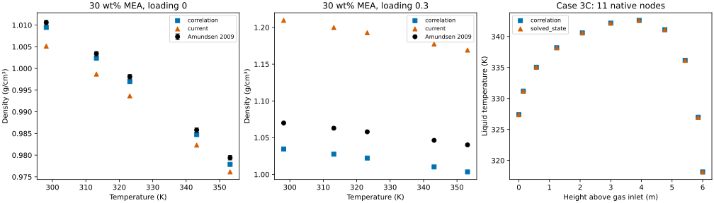

## Question and decision

Issue [#83](https://github.com/tannerpolley/MEA-Absorption-Column/issues/83)
asks whether using the solved liquid density improves the column calculation.
The density observations favor retaining the empirical correlation for hydraulics.
Neither the correlation nor the current ePC-SAFT record resolves the admitted
unloaded observations within their combined uncertainty. The loaded observations
show a larger positive discrepancy for the current ePC-SAFT record, but have no
row-level uncertainty. They provide a discrepancy comparison, not an uncertainty
weighted validation score.

The older column path uses `density_expression` in
`src/mea_absorption_column/Properties/Thermophysical_Properties.py`.
It is a modified Morgan-form correlation that uses the apparent-component mean
molar mass of CO2, MEA and water. Only its additive-volume denominator matches
Morgan et al. (2015, *AIChE Journal*, [doi:10.1002/aic.14762](https://doi.org/10.1002/aic.14762),
p. 1830, Eqs. 20 and 24, Table 5); Morgan uses the true-species mean molar mass.
The implemented volume terms depend on composition for CO2 and MEA and on
temperature for pure MEA and water. This is not the Amundsen observation table itself.
The twelve-state path already uses the native solved ePC-SAFT density.
This distinction corrects the premise that every column path currently uses the correlation.

No default was changed. The twelve-state comparison accepts explicit
`numerics.solver_settings.liquid_density_source` values `solved_state` and
`correlation`; omission preserves `solved_state`. The correlation branch changes
hydraulic mass density and volume, including their downstream effect on apparent
concentration and bulk diffusivity. True-species film concentrations, activities,
fugacities and calorics remain native thermodynamic quantities.

## Observation basis and retained identities

The admitted source is Amine-Thermodynamics film-input bundle 3,
`data/reference/MEA/film_chemistry_inputs/3/input.json`, property input
`liquid_density_unloaded`. Its observation table is
`data/reference/MEA/observations/density_viscosity/Amundsen_2009_density_viscosity.csv`
(SHA-256 `7322b7dc7f0c961d09dbfb356dccde00851c0de20ba589d150d9c3834900f70c`).
The table is read directly, with no bundle repin or source edits.
Amundsen et al. (2009), DOI [10.1021/je900188m](https://doi.org/10.1021/je900188m),
Table 1 contains 35 unloaded values at 298.15–353.15 K and solvent MEA mass
fractions 0.2, 0.3, 0.4, 0.5, 0.7, 0.9 and 1.0.
The applicable combined absolute uncertainty is 0.0005 g/cm³.
Tables 2–4 contribute 68 loaded density rows. Bundle 3 admits no row-level
uncertainty for them: its general estimate excludes unspecified high temperature
and loading conditions, so it cannot be assigned to individual rows.

Pressure is unreported; all property comparisons assume 101325 Pa. This is an
input assumption, not a pressure validation. Apparent feeds use elemental formula
molar masses (CO2 0.044009, MEA 0.061084, water 0.018015 kg/mol).
CO2 loading is mol CO2/mol MEA; MEA mass fraction is on the CO2-free solvent basis.
The unloaded ePC-SAFT points use an exact zero-CO2 neutral liquid root on the binary MEA/water basis,
including the pure-MEA endpoint; no positive loading proxy is substituted.
The loaded ePC-SAFT points use nine-species reactive equilibrium. The legacy
correlation retains its implemented rounded molar masses. For the controlled
column, volume is conserved solution mass flow divided by correlation mass
density, avoiding a mismatch between apparent and true mole counts.

The Engine quantity is `SolvedStateObservableKind.PhaseMolarDensity`, in mol/m³,
returned by the solved liquid state. The column uses
$Q_L=\sum_i n_i/\rho_{\mathrm{mol}}$ and
$\rho_{\mathrm{mass}}=\rho_{\mathrm{mol}}\sum_i x_iM_i$ on the true-species basis.
The pin is Engine commit `f4566b3d0c64d05822b41fe363de47ab5cfa6a0e`, wheel
SHA-256 `57bdf6c4277722fdf378107fa940fd321a4e9caeed8875165a27c318239dbd4a`.
The current MEA dataset is `MEA_greenfield_exploratory`, adopted record `868a5018…`.
Full input hashes, paths and pressure assumption are retained in
[inputs.json](results/runs/current_pin/inputs.json).

## Density comparison

Signed deviation means prediction minus observation. The uncertainty ratio below
is RMSE divided by the supplied combined absolute uncertainty; it is not a
statistical z score or a reduced chi-square.

| Unloaded model | Rows | Bias (g/cm³) | RMSE (g/cm³) | Mean absolute error (%) | RMSE / uncertainty | Rows within ±0.0005 g/cm³ |
|---|---:|---:|---:|---:|---:|---:|
| Correlation | 35 | −0.003995 | 0.005552 | 0.4132 | 11.10 | 7 |
| Current ePC-SAFT | 35 | −0.005475 | 0.006638 | 0.5534 | 13.28 | 3 |

| Loaded model: no row-level uncertainty | Rows | Bias (g/cm³) | RMSE (g/cm³) | Mean absolute error (%) |
|---|---:|---:|---:|---:|
| Correlation | 68 | −0.03434 | 0.04118 | 3.199 |
| Current ePC-SAFT | 68 | +0.12176 | 0.14295 | 11.356 |

These are physical observation comparisons over the stated compositions and
temperatures, not blanket physical validation. No row uncertainties are invented
for the loaded data. No fitting, pressure correction or interpolation is performed.
All row values, signed errors and unloaded uncertainty ratios are retained in
[density.csv](results/runs/current_pin/density.csv); aggregate values are in
[density_summary.json](results/runs/current_pin/density_summary.json).

## Recovered candidate and scope

The parked branch `work/160-amine-density-cp`, commits `05caf9f` and `bb70f6f`,
was inspected along with its notebook, density translation probe, producer and
candidate parameter record. It reported a 65-node candidate column calculation
and a density-only ion-volume translation, using an earlier Engine wheel.
Those numerical values are not reused as current-pin evidence.
Only the candidate input directory is recovered; retired Engine interfaces,
parameter-transfer initialization changes and candidate caloric checks are not restored.

The unchanged candidate parameter SHA-256 is
`756fec502d3a1433d538abb073c4caeabf91902013ab7e27d5459ce70396543b`.
Its metadata specifies a density-only added volume proportional to protonated
MEA plus carbamate amounts, with coefficient 39.51429527803833 cm³/mol.
That translation is an empirical correction, not the raw EOS prediction.
The current Engine rejects the unchanged candidate with
`ParameterError: missing cross association or no_cross_association: carbon-dioxide/monoethanolamine`.
No association rule is guessed to obtain a candidate prediction.
The refusal is retained in
[parameter_load_failures.json](results/runs/current_pin/parameter_load_failures.json).
The candidate therefore contributes no current-pin density or column result.
Parameter adoption and repair remain with Amine-Thermodynamics; `work/160` is preserved.

## Controlled case 3C comparison

Both runs use the corrected published case 3C input from
`analyses/bvp_solution_methods/input/case_3c.json`, 11 cosine-upwind nodes,
five film quadrature points, maximum 20 iterations, the existing $10^{-7}$
scaled residual tolerance and a 1450 s execution wall limit per run.
They use the same current MEA thermodynamics, reactive film, calorics and feed inputs.
The density source alone changes. The bounded commands run with `nice -n 10`.
Capture and temperature differences are numerical sensitivity predictions on this
coarse mesh; no mesh independence or physical column validation is claimed.
The assumed 318.15 K liquid inlet, estimated species mobilities and reported-total-wet
gas basis are retained limitations of this case.

Both runs pass numerical acceptance and the native-grid physical certificate.

| Density source | Capture (%) | Peak liquid temperature (K) | Liquid volume flow range (L/s) | Liquid holdup range (bed fraction) | Maximum scaled residual | Runtime (s) |
|---|---:|---:|---:|---:|---:|---:|
| Correlation | 89.95381 | 342.60822 | 2.04538–2.13376 | 0.054783–0.062539 | 6.63 × 10⁻⁹ | 46.70 |
| Solved ePC-SAFT | 90.02429 | 342.60892 | 1.68128–1.84602 | 0.048326–0.052715 | 7.29 × 10⁻⁹ | 49.06 |

Solved-state density increases capture by **0.07048 percentage points**.
The maximum absolute native-node temperature difference is **0.02766 K** for
liquid and **0.01908 K** for vapor. Its hydraulic volume flow and holdup are
lower, despite the small capture and temperature response. The range extrema
need not occur at identical heights; complete matched-node values are retained
in [profiles.csv](results/runs/current_pin/profiles.csv).
The numerical summary is [column_summary.json](results/runs/current_pin/column_summary.json),
with full attempts under `results/runs/current_pin/solved_state/` and
`results/runs/current_pin/correlation/`.

**Recommendation:** retain the empirical hydraulic correlation where it is
already used, and select it explicitly for density-sensitive twelve-state
studies. Keep solved-state density available for thermodynamic concentrations
and controlled comparisons. The present density data give no accuracy reason
to replace the correlation with the current raw EOS record. The twelve-state
default remains unchanged pending owner approval. Improving loaded density
requires source-owned parameter work or an explicitly qualified correction;
the parked candidate is not a usable current-pin alternative.

The small 3C capture and temperature differences are conditional on this coarse
mesh and fixed transport model. They do not show that a 0.07048-point difference
is mesh resolved, nor that density is unimportant for hydraulic design.
This is a numerical comparison, not physical validation of the predicted
holdup or liquid volume. The observation comparison and the column sensitivity
answer different parts of the decision.

## Evidence and reproduction

From the repository root, run `bash scripts/setup_environment.sh`, then use
`nice -n 10 uv run --frozen python analyses/liquid_density/scripts/compare.py`
with stages `properties`, `solved_state`, `correlation`, then `summarize`.
Column output directories must be new; existing attempts are deliberately not overwritten.
The presentation stage is
`uv run --frozen python analyses/liquid_density/scripts/render.py`; it reads retained
CSV values without rerunning thermodynamics. The figure uses discrete predictions
at observation coordinates and native column nodes; it implies no interpolated curve.

The initial correlation graph construction refusal is retained under
`results/runs/current_pin/correlation_expression_refusal/`; a symbolic vector
needed conversion to the list accepted by the existing correlation expression.
The refused attempt supplies no physical result. Successful attempts and logs
remain separate. No test, tolerance, reference value or default was changed.
The persistent behavior check command `nice -n 10 uv run --frozen pytest -q` returned
287 passed and the two documented #81 singular-Jacobian failures, with one
existing transport-domain warning, in 83.33 s. The full log is
[pytest.log](results/runs/current_pin/pytest.log).
The final-mode Engine integration check passes without editable Engine state.

HSL, a collection of Fortran codes for large-scale scientific computation.
https://www.hsl.rl.ac.uk/

This exploratory notebook has not been independently reviewed or promoted by
the investigator for manuscript use.
