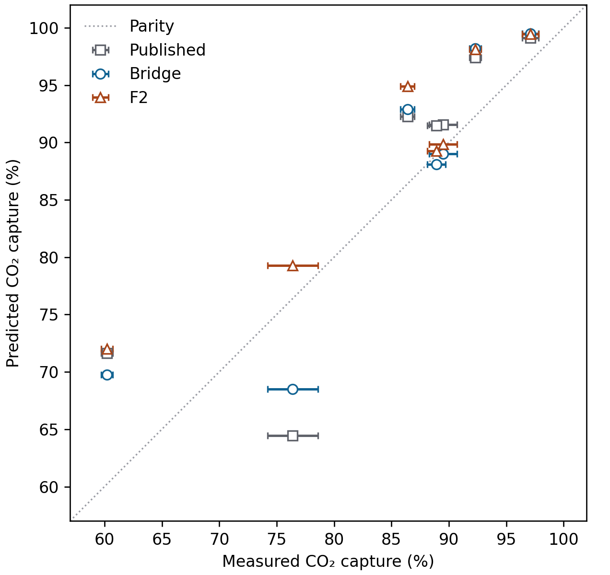
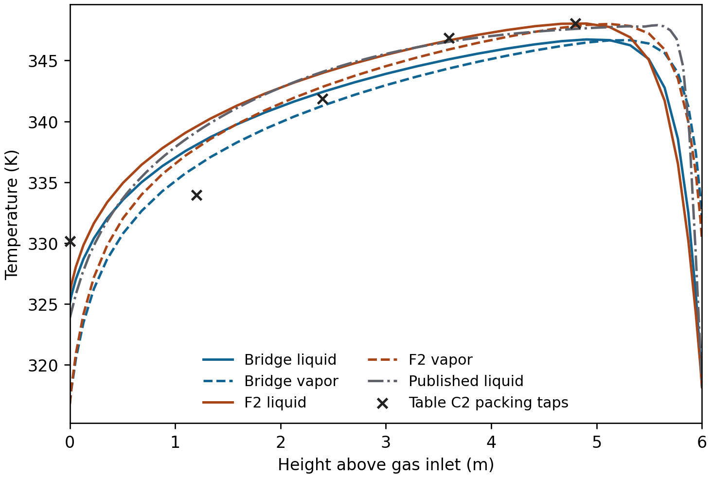

# Decision addressed

This notebook asks why the retained reactive ePC-SAFT Case 3C calculation
predicts lower carbon-dioxide capture than the prior fugacity-only calculation,
and whether a liquid-film calculation using the same nonlinear
fugacity--composition relation changes the transport interpretation. It
synthesizes reviewed retained results; rendering does not rerun a column,
thermodynamic, or film calculation.

The result is a bounded diagnostic, not a predictive absorber validation. The
nonlinear film calculation checks three retained bulk states, with mesh and
initialization sensitivity evaluated at Position 1. It uses effective-Fick
transport and a forward concentration-basis carbamate rate. It does not
establish column-wide capture, reversible absorption/desorption behavior,
wetted-wall-column agreement, or Maxwell--Stefan transport accuracy.

# Work Package A property admission after the source correction

The owner selected Amine-Thermodynamics film-input bundle 3 for the current
Work Package A identity (issue #78, 2026-10-29). The bundle is pinned at
`a6de0317333e9b4bbd65537d285bfe3a384101c7` by the SHA-256 hashes of
`3/input.json`, `3/schema.json` and `3.receipt.json`.
Amundsen2009 pp. 3096–3100 provides general loaded-system uncertainty
estimates with unnamed exceptions at the highest temperatures and loadings;
these estimates cannot be assigned to individual loaded rows. Bundle 3 splits
viscosity admission by loading state. Version 2 remains reserved for the
Work Package B release.

| Quantity and loading state | Bundle-1 admitted rows | Bundle-3 admitted rows | Bundle-3 row uncertainty |
|---|---:|---:|---|
| Unloaded density | 35 | 35 | 0.0005 g/cm³ |
| Loaded density | 68 | 0 | unavailable |
| Unloaded dynamic viscosity | 35 | 35 | 1% |
| Loaded dynamic viscosity | 75 | 0 | unavailable |

The [retained comparison](results/runs/issue78_bundle3/comparison.json) records
source hashes and before/after results. The 322-row source reconstruction
replays exactly, including 23 Amundsen density-model evaluations. These are
source reconstructions, not admitted physical film inputs. The 13 transport
records still describe five comparison states, with zero evaluated or admitted
states. All five release states remain blocked, with zero admitted states and
zero release files created. Their state values and decisions are unchanged
apart from provenance. No flux, propagated uncertainty or capture difference
can be inferred. The absent-file guard passes and an existing-file sentinel is
rejected; the pinned upstream revision also contains no version-2 release file.
A table is sufficient for this categorical admission decision; a trend plot
would not clarify it.

The transport and release checks each have `execution.wall_limit_s = 120` and
a retained log under `results/runs/issue78_bundle3/`. The
[correction run](results/runs/issue78_bundle3_correction/release/summary.json)
recovers the exact parameter archive from Amine-Thermodynamics commit
`97e9c15ca6b6ed78a0e9453ae80c5c3fd0ab8411` into ignored scratch. It was deleted
from the upstream checkout by `ca21408`. The existing `validate_bundle` check
verifies outer SHA-256
`4139fecd9b5192e7cadd12883d2ff1bff71c20d74950af5256e4f0447995f27b`,
all 12 listed archive members, and the wheel member. The correction run retains its
120 s wall limit, acquisition identity and verification log.

The issue33 input now makes loaded row-level combined density uncertainty
unavailable (`null`). Its general 0.2% loaded-system estimate is retained
separately as non-row-level, and no absolute loaded row uncertainty is
calculated from it. The density values and interpolation model are unchanged;
the density-source choice remains under issue #83.

The issue33 concentration replay remains a pre-existing runtime gap: it failed
before calculation in less than one second because its imported
`tabulated_epcsaft_reactive_chemical_equilibrium` function is absent. That
function disappeared in the 2026-09-08 reconciliation
(`f4f5bb9`/`783570a`/`26fa66c`), not in issue #76. Runtime restoration cost is
unknown. The earlier Position 1 value, 4.889309897097635 mol/L, is retained
evidence only, not a bundle-3 calculation.

All 1,013 previously retained NCCC result files remain byte-unchanged. Their
[superseded-source note](results/final/SUPERSEDED.md) disallows their use as
current loaded-row uncertainty or admission evidence. Earlier notebook results
below retain their stated input basis. The bundle-3 checks verify source
identity and admission decisions; they do not provide physical validation.
They have not been independently reviewed or promoted for manuscript use.

# F2 equilibrium replay on Engine 1.0.0

The six observables are compared against the Amine-Thermodynamics F2 replay using the $10^{-8}$ relative limit in [issue #91](https://github.com/tannerpolley/MEA-Absorption-Column/issues/91).
All selected rows have a retained convergence floor at or below $10^{-9}$.
Among the partial-pressure rows at the highest eligible temperature, 333.15 K, `vle_obs_0202-pco2` has the lowest retained floor.
[Amine dataset declarations](https://github.com/tannerpolley/Amine-Thermodynamics/blob/761e38ae8/analyses/solvent_specification_mea/declarations.toml) and [retained F2 values](https://github.com/tannerpolley/Amine-Thermodynamics/blob/761e38ae8/analyses/mea_parameter_bundle/results/adoption-340/candidate/replay.json) identify the feeds, pressures and phase supports.

The 293.15 K carbamate row is an isothermal equilibrium calculation with no caloric observable. The column declaration uses the common reaction and caloric interval of 298–393.15 K.
The table reports six discrete observables with different units, so a plot would add no comparison.
The replay verifies numerical agreement at these specified states. It provides no measurement uncertainty, physical validation or column result.
The CO₂ partial-pressure replay ends at 333.15 K and leaves the hotter column states untested on that equilibrium route.



# Bridge and F2 numerical verification and measurement comparison

The bridge runs use `MEA_greenfield_exploratory` with the twelve-state equilibrium-manifold film, solved-state density, upwind discretization, nine film points, and a scaled residual limit of $10^{-7}$. The 33-node cosine mesh uses the certified 17-node cosine profile as a warm start. The [case rules](inputs/joint_fit_f2/case_rules.md) reproduce the retained 3C input within $10^{-12}$ absolute before generating the six other declarations. The 3C calculations use the unchanged retained declaration.

The 1C seed originally stopped before IPOPT with liquid-minus-gas CO₂ flux residuals of −0.192461 and −0.159583 mol/(m² s) at log interface-to-bulk loading ratios 0 and 1. The extended probe returned −0.011448 at 1.25 and +0.786466 mol/(m² s) at 1.50. The root near 1.257766 gives a seed interface loading of 0.527633 mol CO₂ per mol MEA. The selected bracket is `[0, 1.5]` for 1C. The other cases kept `[0, 1]`. [Original 1C diagnosis](results/runs/joint_fit_f2_20261123/bridge/1C/17/seed/diagnosis.json) · [Extended 1C probe](results/runs/joint_fit_f2_20261123/bridge/1C/17/seed/extended_probe.json) · [Initialization issue #19](https://github.com/tannerpolley/MEA-Absorption-Column/issues/19)

F2 uses the bound `MEA_F2_ae17803e` parameters, reactions and calorics with the same physical case inputs and baseline numerics as the bridge. F2 was fitted on Engine 1.3.0; these absorber predictions were calculated on the pinned Engine 1.0.0. All seven F2 interface initializations passed on the inherited brackets. The F2 1C root was 1.268921 on `[0, 1.5]`. At a matched mesh, F2 minus bridge is the record effect. It includes the joint change in parameters, reactions and calorics. [F2 thermodynamic inputs](results/runs/joint_fit_f2_20261123/f2/inputs/thermodynamics.json) · [1C F2 interface check](results/runs/joint_fit_f2_20261123/f2/1C/17/interface_sign_check.json)

Temperature span is the minimum and maximum over both phases at the native grid nodes. The bridge reaction and caloric interval is 293.15–393.15 K and the F2 interval is 298–393.15 K. Certification checks original bounds, balances, interface and boundary residuals, film-quadrature charge, and the direction of CO₂ removal. The measured capture and its steady-state standard deviation come from Morgan et al. (2020), Table A1. That standard deviation describes measurement variability. The signed mesh change in capture is given in percentage points.



The 17-node cosine 3C result reproduces the retained prediction of 89.41488041587351% exactly. The 3C unclustered timing probe predicted 92.6700% after six IPOPT iterations in 116.19 s. [3C timing probe](results/runs/joint_fit_f2_20261123/bridge/3C/17/seed/summary.json)

All fourteen bridge reporting profiles passed certification with native-grid temperatures spanning 316.25–348.71 K. The largest mesh change occurred on 7C, where refinement lowered capture by 5.55 percentage points to 68.52%, 7.88 points below the measured mean. At 33 nodes the predictions exceed the measured means by 5.88, 6.51 and 9.56 percentage points on 2C, 5C and 6C. On 6C, refinement raised capture by 0.08 points to 69.76%. The two meshes leave the discretization error at finer resolutions unresolved.

All fourteen F2 reporting profiles passed certification with native-grid temperatures spanning 316.25–350.08 K. The 4C 33-node peak of 350.081 K lies 0.081 K above the 316–350 K study domain declared for this comparison and inside the F2 reaction and caloric interval. The largest 33-node record effect was +10.7605 percentage points on 7C. The F2 prediction there was 79.2817%, compared with 76.4 ± 2.2% measured. Refining from 17 to 33 nodes lowered 7C capture by 6.1735 points in F2 and 5.5545 points in the bridge. The record effect moved from +11.3796 to +10.7605 points. At 1C and 2C the 33-node record effects were −0.0376 and −0.0659 points, respectively, smaller than the observed 17-to-33 changes in either arm.

Four attempts hit their wall limits while other jobs were running on the machine. No contemporaneous CPU or memory measurement was retained, so the cause of the slowdown is undetermined. Each last checkpoint reached the global solve, with no native callback failure recorded at that checkpoint and no final IPOPT residual. The configured worker limit and the elapsed parent time are recorded separately. The 1C cosine and the 4C and 5C 33-node retries certified with the same settings and limits. The 2C cosine run started directly from its checked feed seed after the unclustered attempt timed out. [1C cosine log](results/runs/joint_fit_f2_20261123/bridge/1C/17/cosine/run.log) · [2C unclustered seed log](results/runs/joint_fit_f2_20261123/bridge/2C/17/seed_retry/run.log) · [4C 33-node log](results/runs/joint_fit_f2_20261123/bridge/4C/33/run.log) · [5C 33-node log](results/runs/joint_fit_f2_20261123/bridge/5C/33/run.log)



## F2 1C iteration limit

The 3C F2 unclustered seed passed certification in 145.41 s, with 94.1579% predicted capture and a scaled residual of $2.68\times10^{-8}$. The reporting profiles also certified. Refining from 17 to 33 nodes lowered 3C F2 capture by 1.2041 percentage points. The 33-node F2 prediction is 0.8426 points above the bridge prediction and 0.3504 points above the measured mean of 89.5 ± 1.2%. [F2 3C timing seed](results/runs/joint_fit_f2_20261123/f2/3C/17/seed/summary.json)

The original F2 1C seed exhausted 20 IPOPT iterations in 369.57 s, inside the 900 s worker limit. The seed's interface check passed and all native calls returned. A direct evaluation at 3.1875 m reproduced the vapor-side CO₂ flux mismatch, the largest remaining scaled equation defect. The stop rule halted 2C and 4C in their global seed solves. [Original 1C diagnosis](results/runs/joint_fit_f2_20261123/f2/1C/17/seed/diagnosis.json)

With the same 1C seed, a cap of 60 iterations and a 1500 s wall limit returned `Solve_Succeeded` in 32 iterations and 557.85 s. It certified 99.6844% capture on the unclustered seed mesh at a scaled residual of $1.30\times10^{-9}$. The recorded primal and dual infeasibilities agree exactly through iteration 20. They then fell unevenly through sample 27 before both dropped sharply. Continuing past 20 iterations was sufficient to resolve the failure. The trajectory CSV numbers consecutive samples, including a terminal sample after the reported iteration count. [Certified probe](results/runs/joint_fit_f2_20261123/f2/1C/17/seed/iterations_60/summary.json) · [IPOPT trajectory](results/runs/joint_fit_f2_20261123/f2/1C/17/seed/iterations_60/ipopt_trajectory.csv) · [Trace comparison](results/runs/joint_fit_f2_20261123/f2/1C/17/seed/iterations_60/iteration_comparison.json)

The declared cap is 60 iterations for subsequent checkpoint 3 runs in both arms. All 20 certified bridge attempts under the old cap converged in 4–17 iterations. IPOPT stopped before the cap in each case, so the increased budget leaves these retained calculations applicable. The retained F2 3C solves also finished before 20 iterations. The resumed 2C seed used 22 iterations. [Run policy](results/runs/joint_fit_f2_20261123/f2/inputs/run_policy.json) · [Resumed 2C seed](results/runs/joint_fit_f2_20261123/f2/2C/17/seed/resume/summary.json)



The run files retain CPU and memory measurements at launch and through termination. All resumed runs certified within their wall limits. The retained F2 1C seed diagnosis identifies MA57. HSL, a collection of Fortran codes for large-scale scientific computation. <https://www.hsl.rl.ac.uk/> [MA57 diagnosis](results/runs/joint_fit_f2_20261123/f2/1C/17/seed/diagnosis.json)



## 3C controls

The 65-node calculations use the declared 3C case seed because the retained-profile reader requires matching iteration caps. The hydraulic-density and film-quadrature controls also start from the declared 3C case seed under their respective declarations.



For 3C, the record effect fell from +1.6397 points at 17 nodes to +0.8426 at 33 and +0.4545 at 65. At 65 nodes, the bridge and F2 predicted 88.8398% and 89.2943% capture, respectively, against 89.5 ± 1.2% measured. At 33 nodes, the correlation-density swap changed capture by −0.0694 points for the bridge and +0.0009 for F2. Increasing F2 film quadrature from 9 to 17 points changed capture by −0.0034 points. These control differences apply to 3C at the listed meshes.

## Capture on the reporting mesh

At 33 nodes, capture MAE across the seven cases is **4.58 percentage points for F2**, **4.79 for the bridge**, and **5.85 for the published chapter predictions**. Signed errors are prediction minus the measured mean. The ± values are steady-state standard deviations from Morgan et al. Table A1 [@Morgan2020]. MAE weights cases equally and uses the full retained prediction precision.

| Case | Measured (%) | Published (%) | Bridge (%) | F2 (%) | Published error (pp) | Bridge error (pp) | F2 error (pp) | F2 − bridge (pp) | Bridge − published (pp) |
|:--|--:|--:|--:|--:|--:|--:|--:|--:|--:|
| 1C | 97.1 ± 0.7 | 99.10 | 99.48 | 99.44 | +2.00 | +2.38 | +2.34 | −0.04 | +0.38 |
| 2C | 92.3 ± 0.5 | 97.39 | 98.18 | 98.11 | +5.09 | +5.88 | +5.81 | −0.07 | +0.79 |
| 3C | 89.5 ± 1.2 | 91.54 | 89.01 | 89.85 | +2.04 | −0.49 | +0.35 | +0.84 | −2.54 |
| 4C | 88.9 ± 0.8 | 91.49 | 88.09 | 89.28 | +2.59 | −0.81 | +0.38 | +1.18 | −3.40 |
| 5C | 86.4 ± 0.6 | 92.28 | 92.91 | 94.90 | +5.88 | +6.51 | +8.50 | +1.99 | +0.63 |
| 6C | 60.2 ± 0.5 | 71.65 | 69.76 | 72.03 | +11.45 | +9.56 | +11.83 | +2.27 | −1.89 |
| 7C | 76.4 ± 2.2 | 64.47 | 68.52 | 79.28 | −11.93 | −7.88 | +2.88 | +10.76 | +4.05 |

F2 minus bridge is the **record effect** on the shared formulation and inputs. Bridge minus published combines formulation and input changes. The largest record effect is on 7C, where the bridge and F2 each changed by more than 5.5 points from 17 to 33 nodes. The 33-node values leave 7C capture unresolved with respect to mesh refinement. Across 1C–6C alone, MAE is 4.87 points for F2, 4.27 for the bridge and 4.84 for the published predictions. The seven-case MAE ordering of F2 and the bridge depends on 7C. [Capture values and residuals](results/runs/joint_fit_f2_20261123/comparison/capture.csv)

{#fig-joint-fit-capture width=72%}

## Temperature at the Table C2 taps

Across the 35 taps, the liquid-temperature RMSE is **7.40 K for the published runs**, **6.29 K for the bridge**, and **7.06 K for F2**. Each score uses linear interpolation of the retained liquid profile at the five measured positions per case. Morgan et al. give the fractional coordinate $x$ from the top, so each tap is at $z = H(1-x)$ above the gas inlet. The source reports packing temperatures without a phase designation or tap uncertainty. The pooled score uses all 35 residuals per arm. Peaks are the maximum retained liquid temperatures.

For each published case, the selected run's `T.csv` was read with `git show` at `eef9dce41d415aa1ec87c998f90664e33c745b70` and matched its retained SHA-256. The archived `Position` is the bottom-up fraction $z/H$, with $H=6$ m. All eight published RMSEs reproduce the independent review values to 0.01 K. [Archive paths and hashes](results/runs/joint_fit_f2_20261123/comparison/comparison_sources.json) · [Mapped taps and predictions](results/runs/joint_fit_f2_20261123/comparison/temperature_taps.csv)

| Case | Published RMSE (K) | Bridge RMSE (K) | F2 RMSE (K) | Published liquid peak (K) | Bridge liquid peak (K) | F2 liquid peak (K) |
|:--|--:|--:|--:|--:|--:|--:|
| 1C | 4.68 | 4.10 | 4.08 | 344.16 | 345.83 | 346.88 |
| 2C | 4.61 | 3.49 | 3.68 | 344.79 | 345.75 | 346.78 |
| 3C | 3.79 | 3.11 | 3.30 | 347.91 | 346.73 | 348.04 |
| 4C | 6.35 | 5.32 | 6.27 | 349.76 | 348.71 | 350.08 |
| 5C | 7.14 | 6.08 | 7.22 | 345.04 | 344.50 | 346.12 |
| 6C | 3.80 | 4.04 | 5.44 | 341.24 | 339.99 | 341.85 |
| 7C | 14.82 | 12.51 | 13.66 | 345.77 | 342.68 | 344.83 |
| All 35 taps | 7.40 | 6.29 | 7.06 | | | |

{#fig-joint-fit-3c-temperature width=85%}

## Published and retained arm inputs

The chapter comparison uses the archived `codex/fallback-manuscript` tree at `eef9dce41d41`. Its selected runs use the same Table A1 reported lean-liquid and gas mass rates, lean loading, dry CO₂ and O₂ fractions, and inlet temperatures as the bridge and F2. The pressure and gas-basis changes affect the molar gas feed. Both sets assume saturation at the selected gas inlet temperature and pressure. The archived 3C and 7C input rows came from the mass-input CSV named by their run hashes. The archived feed conversions were checked against the retained inlet profiles for all seven runs. [Exact feed inputs](results/runs/joint_fit_f2_20261123/comparison/inlets.csv) · [Source paths and SHA-256 values](results/runs/joint_fit_f2_20261123/comparison/comparison_sources.json)

| Case | Reported liquid / gas (kg/s) | Lean CO₂/MEA (mol/mol) | Unloaded MEA (wt %) | Dry CO₂ / O₂ (mol %) | Liquid / gas inlet (K) |
|:--|:--|--:|--:|:--|:--|
| 1C | 1.718 / 0.555 | 0.15 | 30 | 7.7 / 10.8 | 318.15 / 316.45 |
| 2C | 2.157 / 0.694 | 0.20 | 30 | 7.7 / 10.9 | 318.15 / 316.25 |
| 3C | 2.088 / 0.559 | 0.25 | 30 | 9.3 / 9.0 | 318.15 / 316.75 |
| 4C | 1.711 / 0.417 | 0.25 | 30 | 10.8 / 7.5 | 318.05 / 316.45 |
| 5C | 1.455 / 0.416 | 0.26 | 30 | 7.7 / 11.0 | 318.15 / 316.45 |
| 6C | 2.129 / 0.750 | 0.31 | 31 | 7.7 / 10.9 | 317.95 / 316.55 |
| 7C | 1.504 / 0.278 | 0.34 | 29 | 10.0 / 9.1 | 317.85 / 316.45 |

| Case | Published pressure input (kPa) | Bridge/F2 gas-inlet pressure (kPa) | Published inlet CO₂ (mol/s) | Bridge/F2 inlet CO₂ (mol/s) |
|:--|--:|--:|--:|--:|
| 1C | 109.1 | 110.7 | 1.4395 | 1.3676 |
| 2C | 109.6 | 112.5 | 1.8011 | 1.7136 |
| 3C | 109.5 | 110.9 | 1.7417 | 1.6540 |
| 4C | 107.7 | 110.4 | 1.4981 | 1.4240 |
| 5C | 108.4 | 108.7 | 1.0795 | 1.0246 |
| 6C | 109.7 | 112.4 | 1.9460 | 1.8498 |
| 7C | 107.3 | 107.7 | 0.9268 | 0.8796 |

| Input or formulation | Published chapter runs | Bridge and F2 |
|:--|:--|:--|
| Bed and packing | One 6.0 m bed, 0.64 m diameter, MellapakPlus 252Y, no intercooling | Same |
| Gas flow and pressure | Reported mass as dry gas, saturated water added, Table A1 top pressure as pressure input | Reported mass as total wet gas, saturated water included, measured bottom pressure at gas inlet |
| Liquid mass and boundary | Loaded mass, unloaded MEA fraction, liquid inlet at bed top | Same, with declared species molar masses |
| Thermodynamic record | Earlier nine-species reactive bundle, Engine 0.2.0.dev0 | Bridge exploratory record and Amine F2, Engine 1.0.0, with record-specific reactions and calorics |
| Film, calorics and density | Enhancement factor, empirical heat capacities, enthalpies and hydraulic density | Equilibrium-manifold film, native phase enthalpies and solved-state hydraulic density |
| Formulation and mesh | Seven-state SciPy BVP, temperature variables, 21 initial nodes, 21–22 final nodes, BVP tolerance 0.5 | Twelve-state conservative upwind IPOPT solve, 33 cosine nodes, nine film quadrature points and scaled tolerance of $10^{-7}$ |

## Matched 3C properties and energy terms

The ranges use all 33 bridge nodes for both records, covering liquid temperatures of 318.15–346.73 K, pressures of 109.904–110.900 kPa, and analytical loadings of 0.2500–0.4013 mol CO₂/mol MEA. Liquid Cp and differential CO₂ absorption heat use derivatives of the equilibrated enthalpy flow at fixed pressure. Cp also holds analytical feeds fixed and uses the loaded mass. Positive absorption heat means an ideal-gas mole of CO₂ at liquid temperature releases heat upon uptake at fixed temperature and other feeds. CO₂ equilibrium pressure is its incipient-vapor partial pressure at the node's liquid temperature and analytical liquid composition. Species fractions use total true liquid moles. Pure-water vaporization enthalpy uses each liquid record's pure-water saturation states at the liquid temperature. Vapor Cp uses the fixed-composition gas at the retained bridge gas temperature, pressure and composition, with the common neutral EOS and each arm's calorics. All 66 reactive bubble points and all 66 pure-water saturation points met their requested Engine tolerances. [Matched node values and native residuals](results/runs/joint_fit_f2_20261123/comparison/3c_properties.csv)

| Property | Bridge range | F2 range | Earlier record deviations | F2 deviations |
|:--|--:|--:|:--|:--|
| Loaded density (kg/m³) | 1145.5–1269.1 | 1032.6–1075.0 | +12.5 to +16.8% vs Amundsen | 0.152% fitted, 0.351% Han |
| Liquid Cp (kJ/(kg K)) | 2.952–3.083 | 3.479–3.640 | −14.6 to −9.8% vs Hilliard | 2.835% fitted, 2.540% broad Cp |
| Differential absorption heat (kJ/mol CO₂) | 80.31–85.43 | 83.37–85.82 | — | 1.969% fitted heat, 7.009% Kim |
| CO₂ equilibrium partial pressure (Pa) | 39.76–1747.01 | 30.08–849.45 | — | — |
| Carbamate mole fraction | 0.02525–0.03784 | 0.02695–0.04285 | — | — |
| Bicarbonate mole fraction | 0.00110–0.00509 | 0.00093–0.00303 | — | — |
| Pure-water vaporization enthalpy (kJ/mol) | 42.000–42.995 | 42.074–43.276 | — | — |
| Gas Cp (J/(mol K)) | 30.56888–31.91678 | 30.56904–31.91720 | — | — |

The earlier signed deviations refer to record `868a5018` in [column issue #31](https://github.com/tannerpolley/MEA-Absorption-Column/issues/31). The F2 deviations are average absolute relative deviations on the fitted and separate comparison datasets in [Amine issue #338](https://github.com/tannerpolley/Amine-Thermodynamics/issues/338). The two sources report different metrics and observation sets. The 3C property ranges describe predicted states.

The 33-node density-only change shifted 3C capture by −0.0694 points for the bridge and +0.0009 for F2. Its scope is hydraulic density in this case. The matched properties change together, so their individual contributions to the capture difference remain unresolved.

The 3C energy calculation uses each arm's own certified 33-node solution. For each upwind cell, the direct sensible term is $\Delta z\,a' U(T_V-T_L)$, where $a'$ is interfacial area per packed length. The CO₂ and water terms multiply the transferred moles per second by the gas-minus-liquid differential enthalpy at the respective phase temperatures. Positive values heat the liquid. The temperature-step term sums the product of the liquid enthalpy-flow derivative with respect to temperature and the change in liquid temperature down each cell. The source-based and temperature-step sensible sums differ because the decomposition linearizes the liquid enthalpy at the upwind state. [Cell terms, transfers and interface energy defects](results/runs/joint_fit_f2_20261123/comparison/3c_energy_cells.csv)

| 3C bed-integrated term | Bridge | F2 |
|:--|--:|--:|
| Direct sensible exchange (kW) | −9.52 | −8.65 |
| CO₂ uptake heat (kW) | +122.73 | +126.61 |
| Water transfer (mol/s into liquid) | −1.592 | −1.382 |
| Water-transfer heat (kW) | −66.02 | −55.74 |
| Pressure contribution to sensible heating (W) | −1.49 | −1.82 |
| Sensible liquid heating from source terms (kW) | +47.1992 | +62.2182 |
| Sensible liquid heating from cell temperature steps (kW) | +48.72 | +64.09 |

The source sum subtracts `pressure_W`, the liquid enthalpy-flow increment $(\partial\dot H_L/\partial P)\Delta P$ stored for each cell. The conserved liquid enthalpy-flow change agrees with the integrated native exchange to within $4.5\times 10^{-7}$ W in both arms. The sensible estimates differ by 1.52 and 1.87 kW in the linearized decomposition. On these solutions F2 has higher CO₂ uptake heat and smaller evaporative cooling than the bridge. The energy terms compare the combined record change.

## Scope of the comparison

These are numerical verification and measurement comparisons on previously studied, one-bed, nominal 30 wt % MEA cases. The exact lean MEA fractions span 29–31 wt %. Both arms use the equilibrium-manifold film. The published predictions use the enhancement factor. The models assume inlet saturation, the manifold uses estimated ion mobilities, and the lean-liquid inlet temperature for 1C–3C is imputed at 318.15 K. F2 was fitted using Engine 1.3.0 and evaluated here using Engine 1.0.0. [Amine issue #340](https://github.com/tannerpolley/Amine-Thermodynamics/issues/340) gives thermodynamic adoption evidence and leaves absorber qualification open. Stripper-temperature assessment belongs to Amine-Thermodynamics. In the earlier 3C hydraulic comparison, bridge loaded density was about 11% high against Amundsen and predicted liquid holdup was about 12–16% lower on the tested basis. [Density comparison](../liquid_density/notebook.qmd)

# Retained evidence and identity

The analysis reads the following retained files:

- `inputs/retained_reactive_case3c/film_states.csv`
  (SHA-256 `2c6172cbd84d11b851168c8d5526c46f62e28ed9dd7d06e6de1bb24bc68d074a`)
- `inputs/retained_reactive_case3c/speciation_table.csv`
  (SHA-256 `36ae5bf625f076e5f31f8a3f26cccd40f9d3d33526190fac97e46e887507bdb4`)
- `inputs/retained_reactive_case3c/speciation_table_summary.json`
  (SHA-256 `fbcbf40414a75d3d325048f740db7a4043dd84ad823ed0ec9e108dd61b2af43a`)
- `results/final/tables/retained_reactive_case3c_diagnosis_summary.json`
  (SHA-256 `e41140224e1898ffb221d4eae1e5cb6c95a6d2fe24502469b6e455fc8d67cdb7`)
- `results/final/tables/retained_reactive_case3c_enhancement_summary.json`
  (SHA-256 `f76fb4ee4a81a43bdb667a94878c1b4676cb30a48ba7192a96df0ab7e9986626`)
- `results/final/tables/retained_reactive_case3c_film_summary.json`
  (SHA-256 `368238c97be50cddf84ff79b3ef990398d5222351c219c2ad0b3492a453677b4`)
- `results/final/tables/retained_reactive_case3c_film_runs.csv`
  (SHA-256 `a6e8cffe9f8e0a11ae6f1996796875c28d539f33b00f2dcb9aeda43b02d062df`)
- `results/final/tables/retained_reactive_case3c_film_numerical_gate.csv`
  (SHA-256 `09707b58eff441fa292280c1030ead160d6cac5601613d9474de60b714306651`)
- `results/final/tables/retained_reactive_case3c_enhancement_film_comparison.csv`
  (SHA-256 `30d4c2a35227f9e43fafa6a5f98b59c26d81f1c2f8c2fc20dad70403294275a8`)

The retained calculation uses ePC-SAFT package commit
`d88f703974fa8d6e7be54ca3cbd51b6f0f78a372`, wheel SHA-256
`81f21a6226de1fb68ca992c17f25e1a4ff7b791d3806220fefca31f7ad615f80`,
and parameter-document SHA-256
`66837ab1c9625f28cf143a8adfea5855db70d3e070d44258d7e6f5f3e133c63b`.
These identities prevent results from different package or parameter revisions
from being combined under one label.

# Calculations compared

## Column driving force

The absorber evaluates vapor and liquid fugacity separately at each bulk
column state,

$$
f_{\ce{CO2}}^L=x_{\ce{CO2}}^L\phi_{\ce{CO2}}^L P,
\qquad
\Delta f_{\ce{CO2}}=f_{\ce{CO2}}^V-f_{\ce{CO2}}^L.
$$

The column does not impose vapor--liquid fugacity equality at a collocation
state because doing so would eliminate the mass-transfer driving force. The
reactive liquid calculation supplies the true liquid composition at specified
temperature, pressure, and apparent liquid composition.

## Enhancement-correlation comparison

Five enhancement calculations were evaluated at the same 21 retained Case 3C
bulk states: the current explicit Luo form, that form without the unexplained
divisor, an explicit Putta-kinetics form, the Gaspar implicit form with the
legacy Henry resistance, and the Gaspar implicit form with the local ePC-SAFT
fugacity slope. Gaspar and Fosbøl formulated their general enhancement method
for reversible reaction and both absorption and desorption [@Gaspar2015]. The
Luo and Putta sources provide the kinetic and rate-based modeling lineage used
in the tested alternatives [@Luo2015; @Putta2016].

The local-slope calculation is a differential diagnostic. It is not a
candidate correlation when the inferred interface concentration lies far from
the bulk state used to calculate that slope.

## Nonlinear reactive film

The Stage A film calculation solves an isothermal, steady, effective-Fick
reaction--diffusion boundary-value problem,

$$
\frac{d C_i}{d z}=-\frac{N_i}{D_i},
\qquad
\frac{d N_i}{d z}=\nu_i r,
$$

with bulk concentrations fixed at the liquid edge. Only carbon dioxide crosses
the mathematical gas--liquid interface; the other species have zero normal
interface flux. The gas-film and liquid-film fluxes close through the nonlinear
ePC-SAFT interface fugacity,

$$
N_{\ce{CO2}}(0)
=k_G\left[f_{\ce{CO2}}^V-f_{\ce{CO2}}^L(\mathbf{x}(0))\right].
$$

The tested forward carbamate rate is

$$
r=\left(k_{\mathrm{MEA}}C_{\mathrm{MEA}}
+k_{\ce{H2O}}C_{\ce{H2O}}\right)
C_{\mathrm{MEA}}C_{\ce{CO2}}.
$$

No separate enhancement multiplier is applied inside this film calculation;
reaction and diffusion determine the interface flux directly. This avoids
combining a mechanistic film flux with an additional empirical reaction
multiplier.

# Results

## The liquid fugacity is not the direct cause of lower capture

The observed Case 3C capture is 89.5%. The prior fugacity-only calculation
predicts 87.183%, whereas the retained reactive calculation predicts 71.151%
on the 51-point mesh. Results from 21, 51, and 81 starting mesh points span
only 0.139 percentage point, so mesh resolution does not explain the decrease.

| Median retained-to-prior ratio | Value | Interpretation |
|---|---:|---|
| Liquid $f_{\ce{CO2}}^L$ | 1.302 | The retained reactive liquid fugacity is moderately higher. |
| $f_{\ce{CO2}}^V-f_{\ce{CO2}}^L$ | 1.543 | The calculated bulk driving force is larger, not smaller. |
| Enhancement factor | 0.483 | The current correlation supplies much less reaction enhancement. |
| Local transfer rate | 0.738 | Lower enhancement outweighs the larger driving force. |

At fixed states, reactive speciation raises the median molecular-carbon-dioxide
mole fraction by a factor of 4.048. The retained parameter changes partly
offset that increase: the total retained-reactive fugacity is 1.543 times the
prior-parameter, legacy-speciation value. The current explicit enhancement
correlation places molecular dissolved carbon dioxide in its instantaneous
enhancement limit, so its median enhancement falls from 273.9 to 125.1. This
species-basis interaction, rather than a collapse of the fugacity driving
force, dominates the calculated transfer decrease.

This result does not prove that the liquid fugacity is quantitatively correct.
Independent pressure comparisons for this parameter document have structured
errors of approximately a factor of two, and the available partitions are not
an untouched replacement validation set. Thermodynamic parameters should
therefore be judged against pressure and speciation observations, not adjusted
to recover one column capture result.

## Correlation alternatives at identical states

All 105 formulation--state rows evaluated, with no failed rows. The current
explicit formula reproduced the retained enhancement values to a maximum
relative error of $5.55\times10^{-16}$.

| Formulation | Median $E/E_{\mathrm{current}}$ | Median flux ratio |
|---|---:|---:|
| Current explicit Luo | 1.000 | 1.000 |
| Explicit Luo without divisor | 0.967 | 0.968 |
| Explicit Putta without divisor | 0.954 | 0.955 |
| Gaspar implicit, legacy Henry resistance | 0.911 | 0.913 |
| Gaspar implicit, local ePC-SAFT slope | 0.616 | 1.801 |

Removing the divisor, changing the rate source, or solving the implicit
equations with the legacy Henry resistance changes the median fixed-state flux
by less than 9%. These changes cannot explain the 18.35-percentage-point
capture error. Replacing the resistance with the local ePC-SAFT slope raises
the median fixed-state flux to 1.801 times the current value, but the inferred
interface-to-bulk molecular-carbon-dioxide concentration ratio has median 3.50
and maximum 74.4. That displacement is outside the infinitesimal interval used
to calculate the slope.

{#fig-enhancement width=98%}

## Nonlinear film result at Position 1

The retained Position 1 state is $T=318.15$ K and $P=109.5$ kPa. The nonlinear
film moves the liquid interface fugacity between the bulk liquid and bulk vapor
values while satisfying gas--film flux closure.

| Quantity | Retained value |
|---|---:|
| Bulk liquid $f_{\ce{CO2}}^L$ | 35.7574 Pa |
| Interface liquid $f_{\ce{CO2}}^L$ | 2637.3664 Pa |
| Bulk vapor $f_{\ce{CO2}}^V$ | 3077.3763 Pa |
| Interface flux | 0.01093746 mol m$^{-2}$ s$^{-1}$ |
| Flux per packed length | 0.80597046 mol s$^{-1}$ m$^{-1}$ |
| Current explicit-correlation flux | 0.45198085 mol s$^{-1}$ m$^{-1}$ |
| Film/current flux ratio | 1.783196 |
| Local-slope implicit flux | 0.76502614 mol s$^{-1}$ m$^{-1}$ |

At this state, the mechanistic film flux is 78.3% higher than the current
explicit-correlation flux. It is 5.35% higher than the local-slope implicit
diagnostic, which indicates that the local derivative anticipated the direction
and approximate magnitude but was not sufficient for the finite interface
displacement. The nonlinear calculation evaluates the fugacity along the film
composition path and therefore removes that extrapolation.

The result supports the hypothesis that the present enhancement calculation is
inconsistent with the retained reactive liquid state. It does not yet report a
revised capture value because only one column state has the mechanistic film
closure.

# Numerical acceptance evidence

The Position 1 film calculation was repeated with 21 and 42 initial mesh
points and genuine initial flux factors of 0.5, 1.0, and 2.0. All six cases
evaluated to the same solution. A separate three-position check evaluated the
lean-end, middle, and rich-end retained states with the direct gas-film
boundary condition.

| Check | Result |
|---|---:|
| Evaluated cases | 6/6 |
| Failed cases | 0 |
| Relative interface-flux spread | $1.53\times10^{-11}$ |
| Maximum interface residual | $1.55\times10^{-11}$ |
| Maximum conservation residual | $5.61\times10^{-10}$ |
| Maximum invariant-source residual | $4.72\times10^{-16}$ |

The three-position gate evaluated 3/3 states with no failures. Its maximum
interface, conservation, and invariant-source residuals were
$1.24\times10^{-11}$, $5.61\times10^{-10}$, and
$2.95\times10^{-16}$, respectively. These extra states test numerical closure;
they do not constitute column-wide transport validation.

These checks establish numerical repeatability for this retained state and
formulation. They do not test kinetic-model adequacy or transport-model
accuracy against independent observations.

# Interpretation

The retained evidence rejects two simple explanations for the Case 3C
decrease. First, the reactive liquid fugacity does not reduce the bulk driving
force; the median driving force increases. Second, modest algebraic changes to
the existing enhancement correlation do not restore the missing transfer.

The evidence also does not demonstrate literal reaction double counting. Bulk
chemical equilibrium defines the liquid boundary state, while film reaction
and diffusion determine how carbon dioxide crosses from the interface to that
bulk state. Both belong in a reactive absorber calculation. The identified
problem is inconsistent species and thermodynamic bases: the bulk calculation
uses reactive ePC-SAFT speciation and fugacity, while the current enhancement
correlation retains a legacy concentration and resistance basis.

The Position 1 nonlinear film calculation is the first direct comparison with
the current correlation. Its higher flux shows that the current correlation can
suppress transfer at this state. This finding is a reason to extend the film
calculation; it is not a reason to tune thermodynamic parameters against column
capture.

# Claim boundary and manuscript use

| Proposed statement | Current status | Required evidence for a stronger statement |
|---|---|---|
| The retained liquid fugacity alone causes the lower capture. | Rejected by the controlled comparison. | None; the retained driving force is larger. |
| The current enhancement calculation is inconsistent with the retained reactive liquid basis. | Supported as a Case 3C diagnosis. | Replication across representative column states and independent transport observations. |
| A nonlinear ePC-SAFT film can be solved at retained absorber states without an extra enhancement multiplier. | Numerically supported at three retained states; initialization and mesh repeatability tested at Position 1. | Reversible kinetics, both transfer directions, and independent transport observations. |
| The nonlinear film restores predictive Case 3C capture. | Not established. | Column integration followed by untuned capture and temperature validation. |
| The retained parameter document is predictive for MEA absorption. | Not established. | Independent pressure and speciation validation plus multi-case absorber validation. |

The manuscript may use the fugacity/enhancement diagnosis as a bounded
limitation and may describe the three-state nonlinear film result as method
development. It should not replace the reported column results or claim
predictive reactive absorber performance until the consistent film closure has
been integrated and validated without adjusting parameters to the Case 3C
capture observation.

# Next scientific checks

1. Replace the irreversible forward rate with an activity-consistent reversible
   rate and verify zero driving force, absorption, and desorption directions.
2. Evaluate representative lean, temperature-peak, and rich-end states using
   the same species, activity, fugacity, and kinetic bases.
3. Integrate the accepted film closure into the column with the empirical
   enhancement multiplier disabled, then rerun Case 3C and the retained
   multi-case validation set.
4. Compare film and column predictions with independent wetted-wall-column and
   absorber observations before migrating a predictive claim to the manuscript.

Until those checks pass, the retained film results remain numerical reference
cases and a mechanistic diagnostic.
