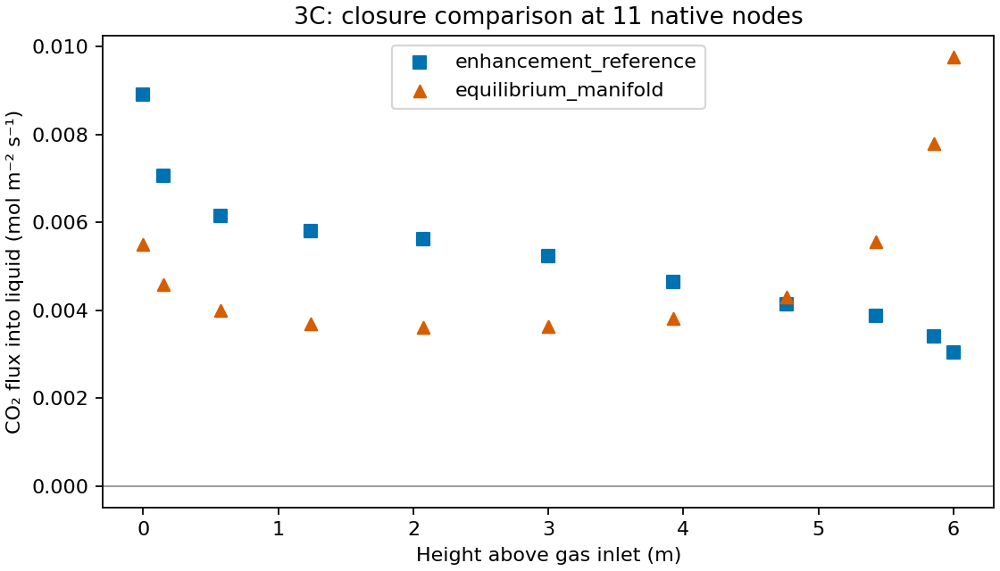
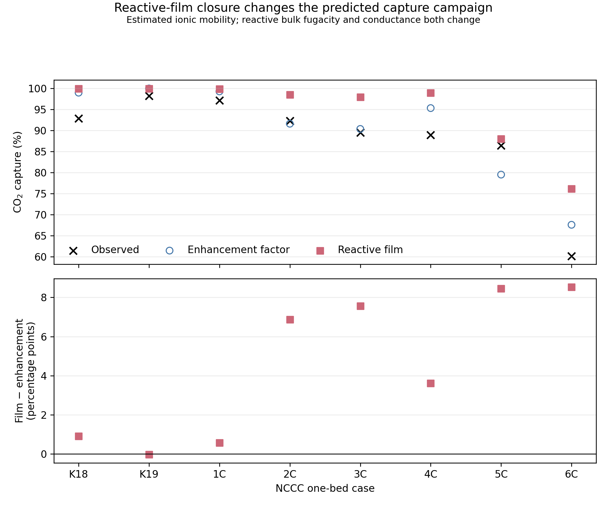
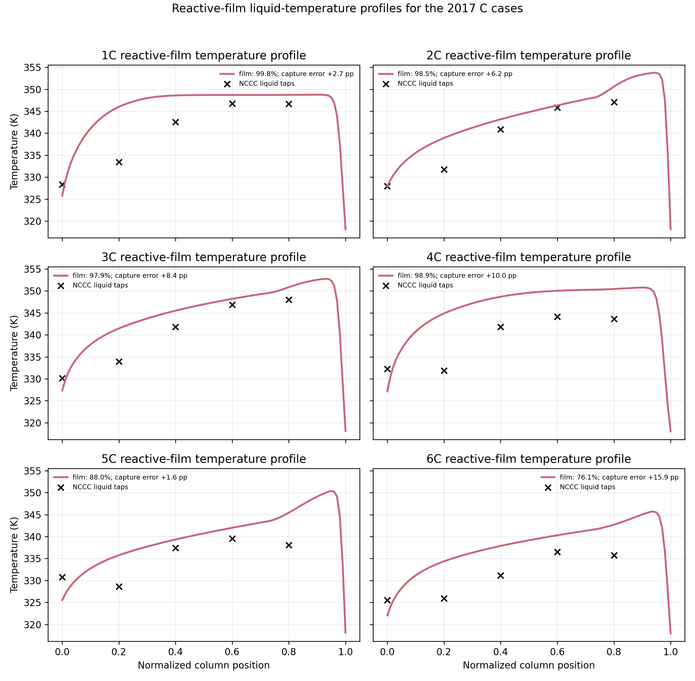
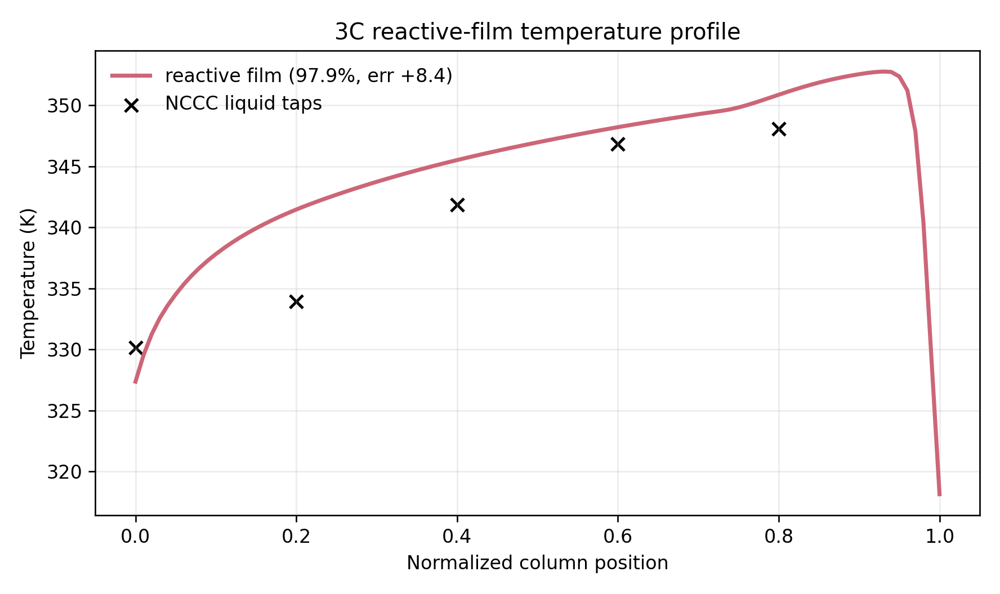

## Current selectable closures: Engine 1.0.0 (issue 16)

The current twelve-state conserved route runs two CO2 closures on the same
nine-species Engine equilibrium and total-enthalpy basis. At eleven cosine-upwind
nodes, the enhancement reference predicts 92.3141% capture and the scalar
equilibrium-manifold film predicts 90.0243%, a difference of -2.2898 percentage
points. This is a numerical comparison of closures, not physical validation or
an adoption decision. The enhancement-factor film remains the baseline pending
#31. The earlier hybrid campaign below retains its original inputs and meaning;
it is not the controlled comparison on the current Engine pin.

### Inventory on the captured main commit

Implementation base: `91ced24149ce7bbed71b1cfba5c78e26bcd9c57d`.
Line locators refer to this commit. A multicomponent mobility is already part of
the scalar film; it is not a third independently selectable column closure.

| Closure | Implementation and selection | Equations and driving force | Species, parameters, sources and domain | Engine 1.0.0 evidence |
|---|---|---|---|---|
| Enhancement factor | `Transport/Enhancement_Factor.py:10` native expression, `:31` conventional expression; `BVP/Coupled_Column.py:214`; twelve-state `model.film_model=enhancement_reference`; seven-state `enhancement_factor` fixed by `config/column.py:659` | Native: $j=E k_L(C_i-C_b)=k_G(f_g-f_i)$. Conventional seven-state: $j=k_G\Psi_H(f_g-f_b)$, $\Psi_H=E k_L/(E k_L+k_G H_b)$ at unit `eta_psi`. Bulk pseudo-second-order kinetics summarized below. | Native nine-species equilibrium; conventional route supports ideal-Henry, neutral, ionic and nine-species thermodynamics. Bulk concentrations, $k_L$, $k_G$, three correlation diffusivities, empirical $E$ bounds and fixed CO2 divisor. Correlations have individual source domains; no combined independently validated loaded-film domain is established. | Twelve-state 3C returned a converged profile; seven-state capability is selected in existing dispatcher, not rerun here. |
| Scalar equilibrium manifold | `Transport/Reactive_Film.py:186` standalone; `BVP/Coupled_Column.py:190` native integral; twelve-state `model.film_model=equilibrium_manifold`. Older `research.py:21` also exposes a frozen `reactive_film_linearization` in the legacy research runner, not the twelve-state closure. | All reactions remain at homogeneous equilibrium. $\delta j=\int_0^{q_i} b_C^T L\,\partial_q(\mu/RT)\,dq$ and $j=k_G(f_g-f_i)$, $q=\ln(\alpha/\alpha_b)$, $\delta=D_{CO2}/k_L$. | Nine species, exact Engine equilibrium loading tangent; estimated species diffusivities and harmonic pair closure. Nonvolatile MEA, stationary water component, zero total molar flux and current constraints. Requires positive compositions, positive conductance, admissible equilibrium branch and exact actions. R5 source ceiling 323.15 K limits physical claims above it. | Twelve-state 3C converged; binary ideal no-reaction reference and signed Engine inlet sentinels pass. |
| Differential finite-rate | Absent from current `src/`; former `solve_reactive_film` and runner are absent. Archive tag contains effective-Fick mode at `Reactive_Film.py:134`. No current column selector. | $N_i=-D_i\,dC_i/ds$, $dN_i/ds=\sum_r\nu_{ir}r_r$; bulk concentrations fixed and gas-film interface closure. Earlier forward-only Luo model differs from subsequent reversible manufactured-rate probes. | Nine true species; finite rates require a reversible activity/concentration partition, coefficient units and standard states; F1/F2 source-unit and basis concerns, F3 missing coefficient, ionic transport missing. Provisional execution does not admit these inputs. | Not executable on main. Archive was inspected, not restored or tested against this wheel. |
| Multicomponent chemical potential | Constrained mobility implemented at `Reactive_Film.py:97,147`, used by the scalar film. Independent differential constrained-Onsager solver only in archive `Reactive_Film.py:134,492`; not selectable on main. | $N=-L\,d(\mu/RT)/ds$ with zero-current and stationary-component projection; differential version also satisfies $dN/ds=\nu r$. | Same nine species, exact thermodynamic composition tangent, electrical constraint and pair mobility. Complete measured Maxwell–Stefan/Onsager matrix is missing; harmonic pairs are estimates, not measured cross coefficients. | Mobility invariant tests and scalar column pass. No separate differential column result or Engine-1.0.0 archive result. |

Paths in the table are relative to `src/mea_absorption_column/`, except archive
paths which refer to the same path under the tag. Configuration and dispatch are
at `config/column.py:618` and `column.py:483`. The twelve-state enhancement reference
uses exact nonlinear interface fugacity, so it is not identical to the seven-state
bulk-Henry resistance approximation.

### Equations, inputs and source limitations

The enhancement reference uses

$$
k_2=(2.003\times10^4 e^{-4742/T})C_{MEA}+(4.147e^{-3110/T})C_{H2O},
\quad Ha=\sqrt{k_2 C_{MEA}D_{CO2}}/k_L,
$$

$$
R_\pm=\frac{D_{MEA}C_{MEA}}{2D_{ion}C_{MEAH^+,MEACOO^-}},\quad
\widehat E=\frac{D_{MEA}C_{MEA}}{2D_{CO2}(C_{CO2}/1.04542981654115)},\quad
E=\min(10^4,\max(1,1+(Ha-1)/(1+Ha(R_++R_-+2)/\widehat E))).
$$

Concentrations are mol m$^{-3}$, diffusivities m$^2$ s$^{-1}$, $k_L$ m s$^{-1}$,
$k_G$ mol m$^{-2}$ s$^{-1}$ Pa$^{-1}$, and fugacities Pa. The retained source trace
is [issue 17's source inventory](../nccc_validation/scripts/analyze_issue17_enhancement_comparison.py),
which separates the current explicit approximation from the complete
[Gaspar and Fosbøl 2015 model](https://doi.org/10.1016/j.ces.2015.08.023).
Luo kinetics are the conventional coefficient choice, not coefficients refitted
in this study. The CO2 divisor has an undocumented calibration basis
(`docs/scientific/latex/sections/model_framework.tex:264`). It is explicitly
retained here; no additional multiplier is applied to either returned flux.
Removing it, changing bounds, or exposing a different kinetic law requires an
approved formulation change. No present result establishes validity of that divisor.

The native enhancement expression takes its three diffusivities from
`Properties/Transport_Properties.py:72` on the apparent concentration basis.
The MEA correlation is the Snijder form; its retained source reconstruction covers
297.9–333 K and 43–5016 mol m$^{-3}$. The complete transport source distinctions
and missing ionic quantities remain in
[issue 42's inventory](../nccc_validation/results/final/tables/issue42_transport_inputs.csv).
The liquid CO2 and ion expressions in the current implementation are retained
correlations; this stage does not establish their complete primary-source
qualification for loaded nine-species transport. No parameters are fitted here.

The scalar film uses pair weights $w_{ij}=c x_i x_j D_{ij}$,
$L_0=\mathrm{diag}(W\mathbf1)-W$, and
$L=L_0-L_0 A^T(A L_0 A^T)^{-1}A L_0$.
$A$ contains the charge and stationary MEA/water component rows;
$\mathbf1^TL=0$ enforces zero molar-average flux. The conserved carbon row is
$b_C=(1,0,0,0,1,1,1,0,0)$.
Pairs use $D_{ij}=2D_iD_j/(D_i+D_j)$, an estimated law.
The exact case-owned values are in
[case_3c.json](../bvp_solution_methods/input/case_3c.json):
$D_{CO2}=3.14\times10^{-7}\exp[-15230/(8.314462618T)]$;
the other species values in native order are
$(8.8,8.8,8.4,6.8,6.8,6.8,18.4390889146,18.4390889146)\times10^{-10}$ m$^2$ s$^{-1}$.
The [anchor inventory](inputs/diffusion_anchor_assumptions.csv) identifies
Jerng2022 low-concentration DOSY measurements (0.1 M MEA/D2O) for MEA/MEAH+
and carbamate. Their use at column loading, water and other-ion assignments,
and harmonic cross coefficients are estimates. The water/other-ion values
and full mobility matrix are not measured loaded-solvent transport inputs.

The finite-rate source record remains
[issue 41's rate table](../nccc_validation/results/final/tables/issue41_source_rate_evidence.csv):
Putta2016 F1/F2 source equations, printed coefficient-unit rejection and unresolved
provider standard-state conversion, plus missing Gondal2015 F3 coefficient.
Its source domain is 293.15–343.15 K, loading 0–0.4 and discrete 1 M/5 M MEA
labels, not blanket admission of all absorber states. Thermodynamic parameters
are upstream-adopted inputs; their pressure/speciation fitting does not fit
transport. Neither closure has an independently validated full transport domain.

### Archive content, preserved without restoration

Tag `archive/issue-47-reactive-bundle-film-2026-09-21` resolves to
`77038167211c24948955f12a1ad8e0a94acf3399`. It contains the differential solver,
its effective-Fick comparison, exact-tangent constrained-Onsager equations,
finite-rate callback, electroneutrality elimination, zero-current checks, and
`tests/test_reactive_film.py:241,308,351` reversible/direction/refinement cases.
Those tests are not the current scalar-film tests and were not executed here.

Its `analyses/reactive_film_evidence/inputs/onsager_diffusivity_closure_policy.json`
declares `estimated_compact_onsager_v1`, factor-two uncertainty and 0.5/1/2
sensitivity, with species values
$(2.6263710575,1.4380630695,1.2,0.84,0.68,0.60,0.55,1,1)\times10^{-9}$ m$^2$ s$^{-1}$.
These differ from the current case-owned scalar-film policy. They must not be
silently substituted. The tag retains the Position 1 provisional result and
source-negative evidence; neither is a new Engine-1.0.0 result. Restoration and
any physics change require an explicit decision before implementation.

### Limit checks and declared tolerances

The bounded [Engine sentinel output](results/runs/engine100/engine_limit_checks.json)
uses the declared 3C inlet liquid state and gas fugacity perturbations of 0 and
±10% relative to its equilibrium CO2 fugacity. These are single-film probes,
not changed column inlet conditions.

| Check | Enhancement reference | Scalar equilibrium manifold | Criterion and scope |
|---|---:|---:|---|
| Zero-drive flux (mol m$^{-2}$ s$^{-1}$) | -1.46e-17 | -4.02e-17 | Absolute flux ≤1e-8 of $k_G f_b=9.9045e-4$ mol m$^{-2}$ s$^{-1}$ |
| Negative-drive flux | -1.61926e-5 | -7.84579e-5 | Same sign as -0.1 $f_b$ |
| Positive-drive flux | +1.62410e-5 | +7.81350e-5 | Same sign as +0.1 $f_b$ |
| Maximum interface relative residual | 3.89e-13 | 1.84e-13 | ≤1e-7 of $k_G f_b$ |
| Bulk charge fraction (mol/mol) | 2.39e-14 | 2.39e-14 | ≤1e-10 |
| No-reaction physical limit | $E=1$ within 1e-12 in the mathematical no-reactant limit | Binary ideal two-film reference, including absorption, zero and desorption | Existing scalar reference tolerance 5e-4 relative or 1e-14 absolute; no full nine-species reaction-off Engine case is exposed |
| Charge/current and material structure | Common column component balances; no species current profile returned | Symmetric positive-semidefinite mobility, zero total flux/current and stationary component tests | Existing mobility absolute tolerance 1e-18; scalar component/total flux ≤1e-12; interface ≤1e-10 |

The standalone checks add no existing test/tolerance/default changes. They
exercise the production expressions, with assertions for independently stated
zero-drive, sign, interface and charge invariants. The no-reactant enhancement
probe is a mathematical concentration limit, not an admitted MEA chemistry
experiment. The ideal binary reference verifies the scalar physical-absorption
limit; it does not disable all reactions in the Engine's nine-species model.
Differential finite-rate and differential multicomponent limits remain untested
on this pin because those implementations are absent.

### Controlled 3C column comparison

Both runs use the same 6 m bed, 0.3216991 m$^2$ area, published 3C conversion,
318.15 K liquid inlet (imputed), 316.75 K vapor inlet, 110900 Pa bottom pressure,
packing, Engine dataset, thermal reference, equilibrium branch, solved-state
hydraulic density, area/transfer correlations and initialization policy.
Only `model.film_model` changes. The two closures consume their own declared
transport approximations above; this is not a comparison at identical effective
liquid-film mobility. Each uses upwind balances on 11 cosine-clustered nodes,
five film quadrature points, 20 maximum iterations, tolerance 1e-7 and
`execution.wall_limit_s=1450`. Runs were launched with `nice -n 10`, concurrently;
costs are single-run elapsed measurements, not repeated performance benchmarks.

| Closure | Capture (%) | Signed node flux range (mol m$^{-2}$ s$^{-1}$) | Scaled residual | Iterations | Elapsed (s) | Outcome |
|---|---:|---:|---:|---:|---:|---|
| Enhancement reference | 92.314091 | +0.00304852 to +0.00891307 | 1.31e-9 | 7 | 17.456 | Numerically accepted; certification reports incomplete capture checks |
| Equilibrium manifold | 90.024290 | +0.00360504 to +0.00975727 | 7.29e-9 | 6 | 43.134 | Numerically accepted; implemented physical criteria pass |



The [profile table](results/runs/engine100/profiles.csv) retains each signed flux,
bulk fugacity drive, temperature and bulk charge. Both signs agree with the
bulk drive at every node. Capture is determined by the conserved inlet/outlet
flows, not by comparing flux extrema. The scaled material drift is 3.69e-16
for enhancement and 3.65e-16 for the manifold, below 1e-7. Energy drift is
6.37e-14 and 2.14e-13. The manifold certification checks charge over film
quadrature (2.33e-14 maximum scaled residual); the enhancement result reports
only a subset certification despite passing its material/interface/boundary
criteria. That flag does not mean its nonlinear solve failed or that the
manifold has been experimentally validated. Neither run failed; there were no
retries or fallback closures.

No mesh-refinement uncertainty is established by this coarse pair. No claim of
predictive superiority follows from proximity to the reported 89.5% capture.
Source uncertainty, provisional caloric inputs and estimated mobilities remain.
The solved-state loaded-liquid density reads about 11% high against Amundsen2009,
reducing holdup about 12–16% on 3C; see [density evidence](../liquid_density/notebook.qmd).
The hydraulic model is held fixed, not calibrated in this study.

### Checklist status and decisions remaining

| Issue 16 completion box | This stage's evidence | Remaining boundary |
|---|---|---|
| Film equations, assumptions, species, parameters and domain | Inventory supplied for all four names | Physical validity remains limited as stated |
| Source-linked kinetics and diffusion status | Retained source tables linked; measured/fitted/estimated/missing distinguished | Missing matrix, kinetics basis and independent rates remain |
| Independent film selection where compatible | Two native choices verified with unchanged Engine and solver inputs | Differential choices absent; archive restoration requires approval |
| Zero drive, sign, no reaction, linear, charge/current and material limits | Available closures pass the bounded checks above | Full reacting domain, nine-species reaction-off and differential checks incomplete |
| Couple flux without second enhancement through #31 | Current scalar integral directly supplies flux; fixed enhancement divisor disclosed | Adoption belongs to #31; no adoption performed |
| Paired Quarto results and all failures | Current fixed-basis pair, profiles, inputs and logs retained; 0/2 failures | Independent review and investigator promotion pending |

These describe evidence, not a request to check every GitHub box as complete.
#31 should use this common-basis pair to specify the adoption comparison and
resolve the enhancement divisor explicitly before changing its baseline.
Restoring a differential alternative and admitting its kinetic/transport inputs
must precede a differential column comparison. #18 should retain the current
fixed physical problem for method comparisons, distinguish scalar quadrature
from differential finite-rate equations, and use the per-run native call counts
when measuring costs; it should not infer a solver defect from the absence of
the archived implementation. No work on #31 or #18 was delegated or executed.

### Retained evidence and reproduction

Engine 1.0.0 commit `f4566b3d0c64d05822b41fe363de47ab5cfa6a0e`, wheel SHA-256
`57bdf6c4277722fdf378107fa940fd321a4e9caeed8875165a27c318239dbd4a`.
Each `attempt.json` retains resolved inputs, immutable asset hashes, configuration,
initial state, source identity, solver diagnostics and thermodynamic call counts.
The production package tree was unchanged; the study drivers were new untracked
files when the source identity was captured. The commit containing this notebook
owns those drivers. Logs and result tables live only under
`results/runs/engine100/` for this comparison.

```bash
nice -n 10 agent-heavy uv run --frozen python analyses/reactive_film_evidence/scripts/compare_closures.py enhancement_reference
nice -n 10 agent-heavy uv run --frozen python analyses/reactive_film_evidence/scripts/compare_closures.py equilibrium_manifold
nice -n 10 agent-heavy uv run --frozen python analyses/reactive_film_evidence/scripts/check_closure_limits.py
nice -n 10 agent-heavy uv run --frozen python analyses/reactive_film_evidence/scripts/compare_closures.py summarize
uv run --frozen python analyses/reactive_film_evidence/scripts/render_closure_comparison.py
```

Focused checks: 19 passed. Full suite: 307 passed, with one existing domain-guard
warning in `test_transport_domain_guards.py`. Final immutable Engine integration
check passed. These results have not been independently reviewed or promoted
for manuscript use. HSL, a collection of Fortran codes for large-scale scientific
computation. https://www.hsl.rl.ac.uk/

## Earlier hybrid campaign (separate input basis)


## Decision

The nine-species fast-equilibrium film model supplies the primary CO2 mass-transfer calculation for the eight retained one-bed cases through a hybrid coupling to six-species outer property calculations. The enhancement-factor calculation is retained as a comparator. Both use the selected ePC-SAFT parameter document by default, but the film supplies a different reactive bulk fugacity and reaction/speciation closure as well as a different conductance. This is not a transfer-only comparison at fixed reactive chemistry. The film model is not fitted to the measured capture percentages.

## Formulation

At each sampled packed-height location, the selected ePC-SAFT bundle supplies a homogeneous nine-species equilibrium state and exact chemical-potential composition tangent. A symmetric positive-semidefinite pair-mobility approximation maps that tangent to species fluxes after projecting out total molar flow, electrical current, nonvolatile-MEA flux, and water-component flux. Water transfer remains the column model's separate two-film calculation. Integration along the fast-reaction equilibrium manifold gives the liquid-film CO2 component flux, and a scalar gas-film balance determines the interface state.

The local film solve is quadrature plus a scalar interface root; it does not impose independent boundary conditions on nine differential species profiles. The packed column remains a boundary-value problem because vapor and liquid enter from opposite ends.

## Retained campaign

| Case | Observed (%) | Enhancement (%) | Film (%) | Film − enhancement (points) | Outer updates |
|---|---:|---:|---:|---:|---:|
| K18 | 92.85 | 98.969 | 99.884 | +0.914 | 17 |
| K19 | 98.21 | 99.968 | 99.938 | -0.031 | 7 |
| 1C | 97.10 | 99.271 | 99.842 | +0.571 | 16 |
| 2C | 92.30 | 91.596 | 98.462 | +6.866 | 14 |
| 3C | 89.50 | 90.356 | 97.913 | +7.557 | 13 |
| 4C | 88.90 | 95.306 | 98.916 | +3.611 | 5 |
| 5C | 86.40 | 79.516 | 87.973 | +8.457 | 18 |
| 6C | 60.20 | 67.605 | 76.131 | +8.526 | 10 |

Exact values and diagnostics are retained in `results/final/tables/column_film_capture_comparison.csv`.

{width=95%}

The reactive-film closure changes predicted capture by -0.031 to +8.526 percentage points relative to the enhancement-factor calculation. Its all-case observed-capture mean absolute error is 6.700 percentage points, compared with 4.038 percentage points for the enhancement-factor comparator. The film formulation therefore changes the physical model but does not improve aggregate agreement with these observations. All eight selected runs meet the declared stopping rule after 5–18 outer updates.

## Temperature-profile comparison

{width=95%}

The six C-case liquid-temperature tap RMSE values range from 3.73 K (2C) to 8.05 K (4C), with a mean of 5.65 K. These profiles replace the temperature figures generated with the former enhancement-factor calculation; they do not add a temperature acceptance criterion. The terminal drop near normalized position 1 is the imposed lean-liquid inlet boundary response.

{width=90%}

For 3C, the reactive-film result is 97.91% capture against 89.50% observed, while the liquid-temperature tap RMSE is 4.18 K. Exact temperature metrics are retained in `results/final/tables/column_film_temperature_metrics.csv`.

## Numerical status

All eight packed-column solves satisfy their mixed boundary conditions at numerical precision. Their maximum collocation RMS residual is 0.066 under the declared 0.1 solver tolerance, and the maximum retained dense-grid ODE residual is 0.112. All eight cases meet the declared outer-film stopping rule. K18, 1C, and 5C require 17, 16, and 18 updates, respectively. The 5C calculation with relaxation 0.25 reaches the same rule at 29 updates but gives 87.788892% capture versus 87.972810% at relaxation 0.5; the 0.183917-percentage-point difference limits claims about a unique fixed point. Both selected values, settings, source commands, and identities are retained in `results/final/tables/column_film_relaxation_sensitivity.csv`. The maximum stationary-component flux residual is $1.32\times10^{-12}$ mol m$^{-2}$ s$^{-1}$, or $9.57\times10^{-10}$ relative to local CO2 component flux.

## Claim boundary

The campaign is a fixed-input engineering prediction: the case inputs, selected nine-species ePC-SAFT bundle, transfer correlations, and declared diffusivity estimates determine the outputs without fitting capture. It is not an independently validated nine-species transport model. Species diffusivities and the pair-mobility closure remain estimated, and no measured full Maxwell--Stefan/Onsager matrix or held-out local film-flux validation is available. The bundle was evaluated as a complete pressure/speciation candidate through 393.15 K, but R5 retains a 323.15 K source-qualified ceiling; 369 of 500 retained sampled local evaluations across outer iterations exceed that source domain and are explicitly temperature-extrapolative.

The investigator authorized use of the retained notebook evidence at commit `4cd362c83e0a6b439655a18819a862da25e782cf` for the manuscript revision, subject to the stated transport, temperature-domain, and numerical limitations. This revision incorporates the completed extended runs and the newly verified hybrid-coupling qualification; it requires review with the revised manuscript.
